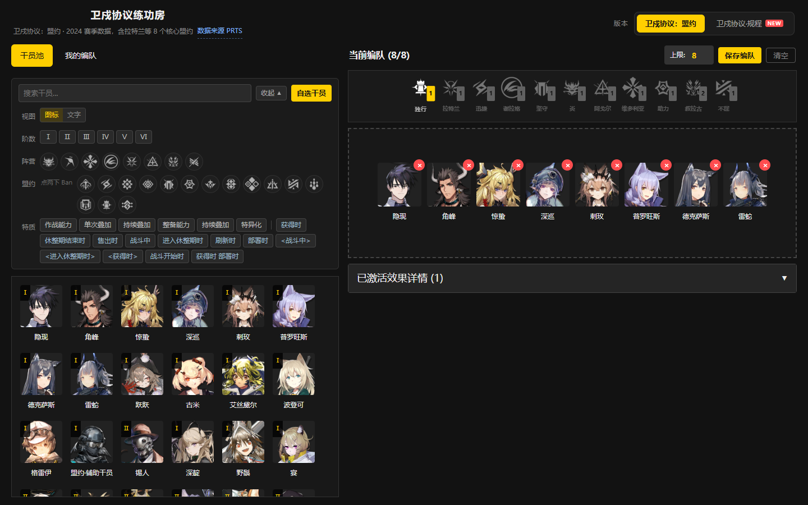
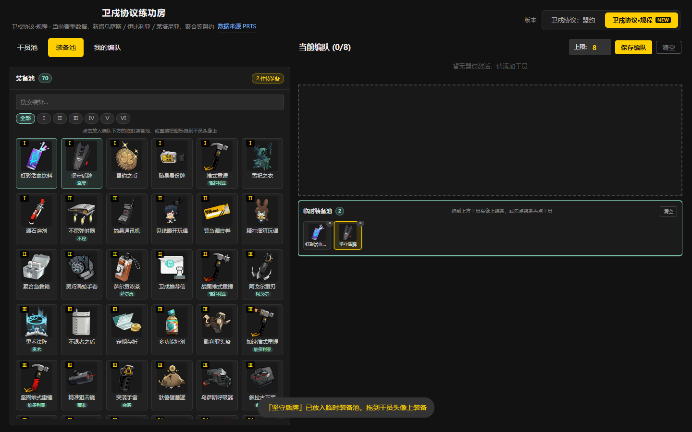
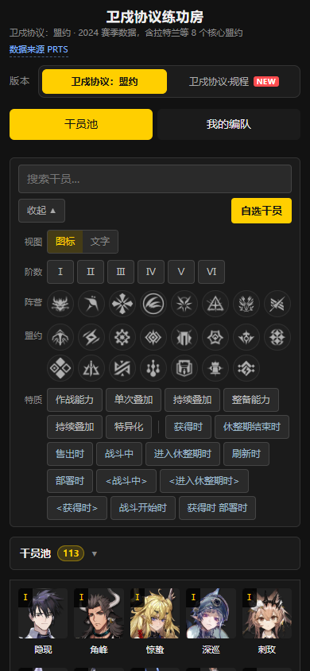
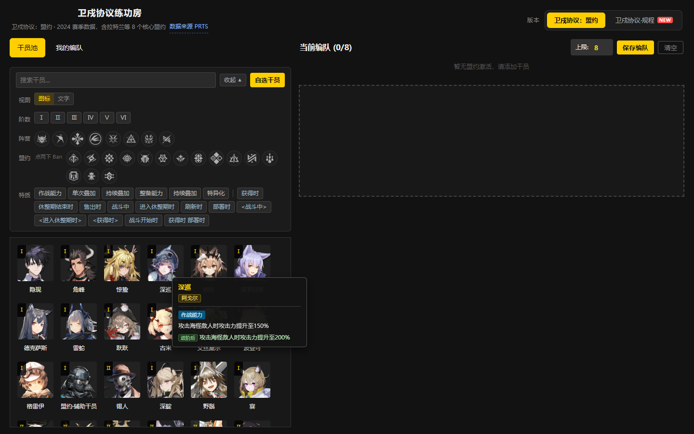

# 卫戍协议练功房

明日方舟「卫戍协议」配队工具。把干员池、盟约层数、装备槽、分享码收进一个页面，用来试阵容、比盟约、存编队。

纯前端应用，无需后端，数据保存在浏览器本地。

**[在线体验](https://yeyeye613.github.io/Arknights-alliance-tool/)**

> 非官方工具，与鹰角网络 / 明日方舟官方无关。数据整理自 [PRTS 明日方舟中文 Wiki](https://prts.wiki)。

## 截图

干员池与当前编队（盟约版），上方是实时统计的盟约人数，下方是已激活效果：



装备池与临时装备池（规程版）——点选或拖拽都行，右侧是移动端布局：

 

悬停干员卡片查看特质，悬停盟约图标查看激活门槛与全部效果：



## 功能

### 双版本数据

页面右上角可切换两个活动的数据，切换结果写入 `localStorage`，下次打开保持上次选择。

| 版本 | 说明 | 核心盟约 | 干员 | 装备 |
| --- | --- | --- | --- | --- |
| 卫戍协议：盟约 | 2024 赛季数据 | 8 个 | 113 名 | 无 |
| 卫戍协议·规程 | 当前赛季数据 | 10 个 | 143 名 | 70 件 |

切换版本后，干员池、阵营 / 盟约筛选、盟约效果文案、已保存列表都会跟着切换。编队里残留的其他版本干员会用红色虚线标出，且不计入盟约层数。

### 干员池

- 按名称搜索，按阶数、阵营（核心盟约）、盟约（附加盟约）、特质类型、特质触发时机筛选
- 盟约按钮三态切换：未选 → 筛选 → Ban → 取消 Ban，一次手势完成「只看这个」和「不要这个」
- Ban 规则按版本区分：规程版 Ban 阵营等于隐藏该阵营全部干员；盟约版需干员全部盟约被 Ban 才隐藏
- 筛选区可折叠，已选条件以摘要回显，可逐项取消或一键清除
- 阵营 / 盟约筛选支持「图标 ⇄ 文字」两种展示，偏好本地记忆
- 自选（甄选）干员：五阶、六阶各最多 2 名，选择状态持久化
- 悬停干员卡片查看特质类别、触发时机、效果与进阶效果

### 当前编队与盟约

- 点击或拖拽入队，拖拽排序，单个移除、一键清空
- 编队上限 1–20 可调，超出上限时自动截断
- 实时统计各盟约人数，标记已激活盟约、进阶等级
- 「调和」激活后为核心盟约额外 +1 的规则已计入统计
- 展开可查看已激活盟约的完整效果说明

### 装备

- 独立「装备池」标签页（仅规程版可见），按等阶与关键词筛选，70 件装备
- 每位干员两个装备槽，支持点选和拖拽两种装配方式
- 「临时装备池」放在编队干员下方，可从池中暂存多件再逐一分配
- 「变形同构体」与指定装备同携时，携带者额外视为对应盟约成员，界面会标注该盟约里有多少人来自装备
- 组合装备（如「不退者之盾」+「不退者力场」）会给出合成提示
- 装备信息随编队一起进分享码

### 编队管理

- 保存、编辑、删除编队，按合集归类
- 合集可展开 / 收起，按当前版本过滤展示，未标记版本的历史存档归入盟约版
- 加载其他版本的编队时自动切到对应版本

### 分享与导入

分享码为自研二进制协议（v3）

- 单字符前缀 `A` + 类型（单编队 / 合集）
- 干员、装备以码表下标引用，varint 编码，超出码表才写名字
- 载荷超过 72 字节才 deflate，最后整体 Base62，不含 `+ / =` 等会被聊天软件吃掉的字符
- 码内记录版本标识，导入时自动切换版本
- 仍兼容 v1 / v2 的 `ARKTEAM` / `ARKCOL` 旧码（全量导出的 `ARKFULL` 从未上线，已随协议清理移除）

### 离线与更新

生产构建注册 Service Worker：应用外壳预缓存，干员头像走运行时 CacheFirst（345 张 / 14 MB 不入预缓存）。发现新版本时弹出提示，由用户决定何时刷新，不打断正在编辑的编队。

## 技术栈

| 类别 | 选型 |
| --- | --- |
| 框架 | Vue 3（`<script setup>`） |
| 构建 | Vite 8 + TypeScript（配置层）/ JavaScript（业务层） |
| 拖拽 | vue-draggable-plus |
| 压缩 | pako（deflate） |
| 离线 | vite-plugin-pwa + Workbox |
| 测试 | Vitest + jsdom + @vue/test-utils |
| 部署 | GitHub Actions → GitHub Pages |

## 快速开始

需要 Node.js 20+（CI 使用 24）与 npm。

```bash
git clone git@github.com:yeyeye613/Arknights-alliance-tool.git
cd Arknights-alliance-tool/frontend
npm install
npm run dev
```

开发服务器默认跑在 `http://localhost:5173/Arknights-alliance-tool/`，注意带基路径。

### 常用脚本

| 命令 | 作用 |
| --- | --- |
| `npm run dev` | 启动开发服务器（HMR） |
| `npm run build` | 类型检查 + 生产构建到 `dist/` |
| `npm run preview` | 本地预览生产构建（PWA 需在此模式验证） |
| `npm run typecheck` | 只跑 `vue-tsc`（.ts 与 .vue） |
| `npm run lint` | ESLint（正确性规则，0 error 为合格） |
| `npm run format` | Prettier 格式化（存量文件尚未整体格式化，建议只对改动文件执行） |
| `npm run test` | 运行 Vitest（默认 watch 模式） |
| `npm run test:run` | 单次跑完全部测试 |
| `npm run coverage` | 生成覆盖率报告（`coverage/`，当前只测量不设阈值） |
| `npm run codebook` | 依据数据文件追加分享码码表 |

### 目录结构

```text
.
├─ frontend
│  ├─ public/resource/image   # 干员头像、盟约与装备图标
│  ├─ scripts/gen-codebook.mjs# 码表生成（只追加）
│  └─ src
│     ├─ components           # 页面组件与弹窗
│     ├─ composables          # 响应式胶水：版本、编队、存储、分享、提示、PWA
│     ├─ domain               # 纯业务规则（无 Vue、无 DOM，可直接单测）
│     ├─ data                 # 版本注册表与各版本数据集
│     ├─ utils                # 分享码编解码、图片地址
│     ├─ tests                # Vitest 单测
│     ├─ App.vue              # 组合根
│     └─ main.ts              # 挂载入口
├─ architecture               # 架构文档
├─ docs/screenshots           # README 截图
└─ .github/workflows/deploy.yml
```

## 文档

| 文档 | 内容 |
| --- | --- |
| [architecture/overview.md](architecture/overview.md) | 总体架构、分层、关键设计决策 |
| [architecture/module-map.md](architecture/module-map.md) | 模块职责、入口与依赖方向 |
| [architecture/data-model.md](architecture/data-model.md) | 核心数据结构、存储键与不变量 |
| [architecture/data-flow.md](architecture/data-flow.md) | 启动、版本切换、盟约统计、分享码等流程 |
| [refactoring-plan.md](docs/architecture/refactoring-plan.md) | 架构审计结论与分阶段重构计划（P0–P5） |
| [docs/CONTRIBUTING.md](docs/CONTRIBUTING.md) | 贡献流程与开发规范 |
| [docs/CHANGELOG.md](docs/CHANGELOG.md) | 版本变更记录 |
| [docs/SECURITY.md](docs/SECURITY.md) | 安全问题反馈方式 |
| [LICENSE](LICENSE) | MIT |

## 数据说明

盟约、干员、特质、装备数据均来自 PRTS：

- [卫戍协议：盟约](https://prts.wiki/w/卫戍协议：盟约)
- [卫戍协议·规程 / PRTS盟约记录](https://prts.wiki/w/卫戍协议·规程/PRTS盟约记录)

数据结构与字段含义见 [architecture/data-model.md](architecture/data-model.md)；需要更新赛季数据时，按 [docs/CONTRIBUTING.md](docs/CONTRIBUTING.md#数据更新流程) 的步骤操作。

## 致谢

- 数据来源：[PRTS 明日方舟中文 Wiki](https://prts.wiki)
- 游戏素材版权归上海鹰角网络科技有限公司所有
- 本项目仅用于配队研究与交流，不作商业用途

## 开源协议

[MIT](LICENSE)
