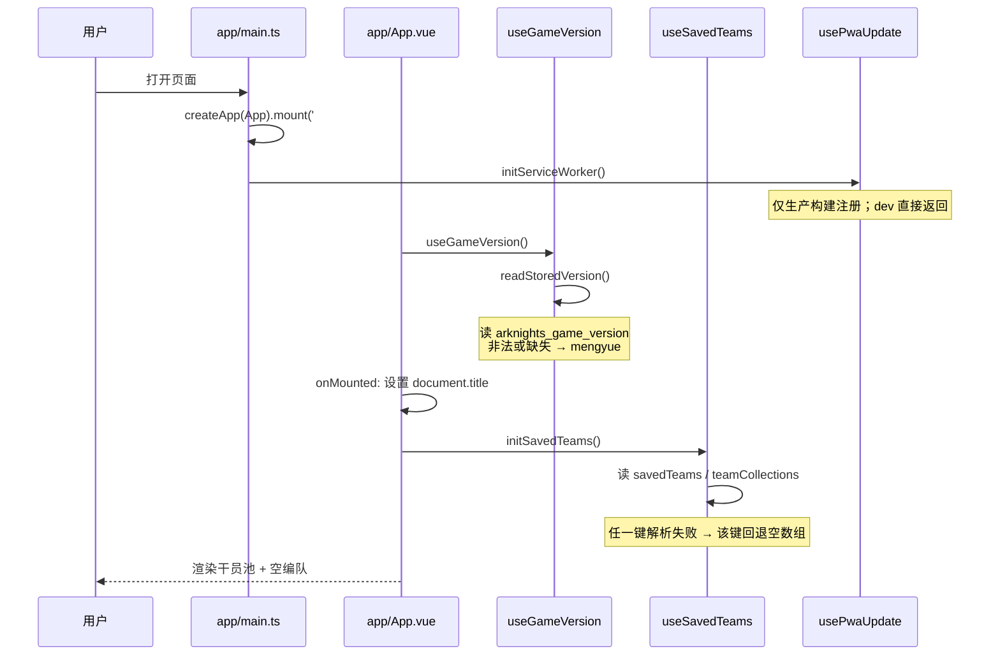
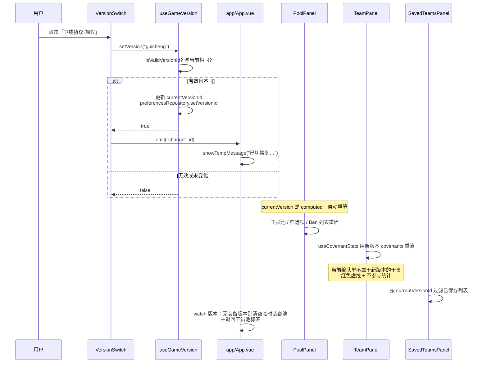
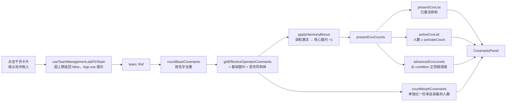
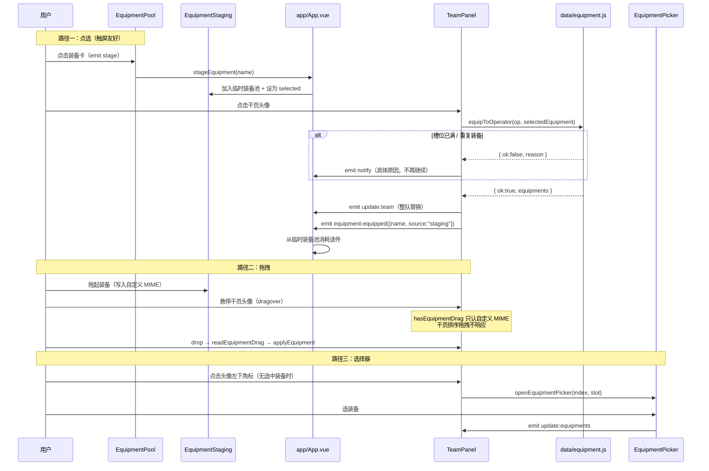
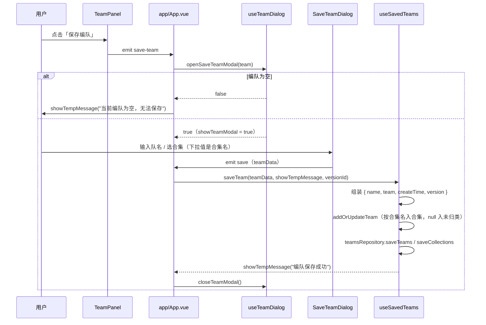
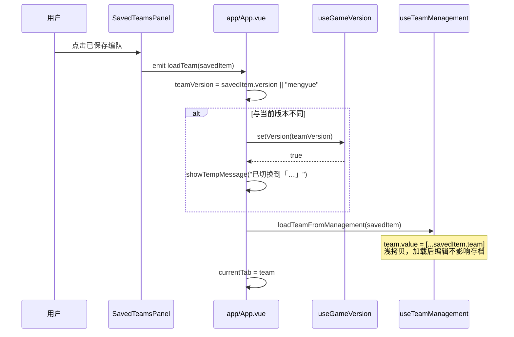
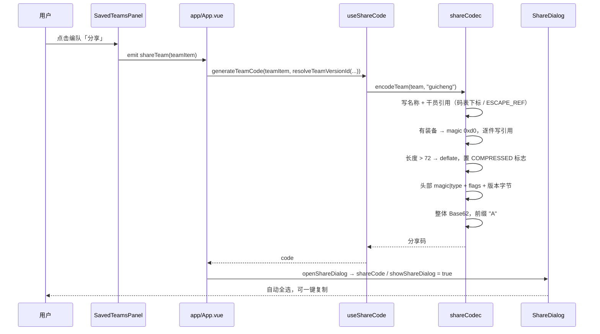
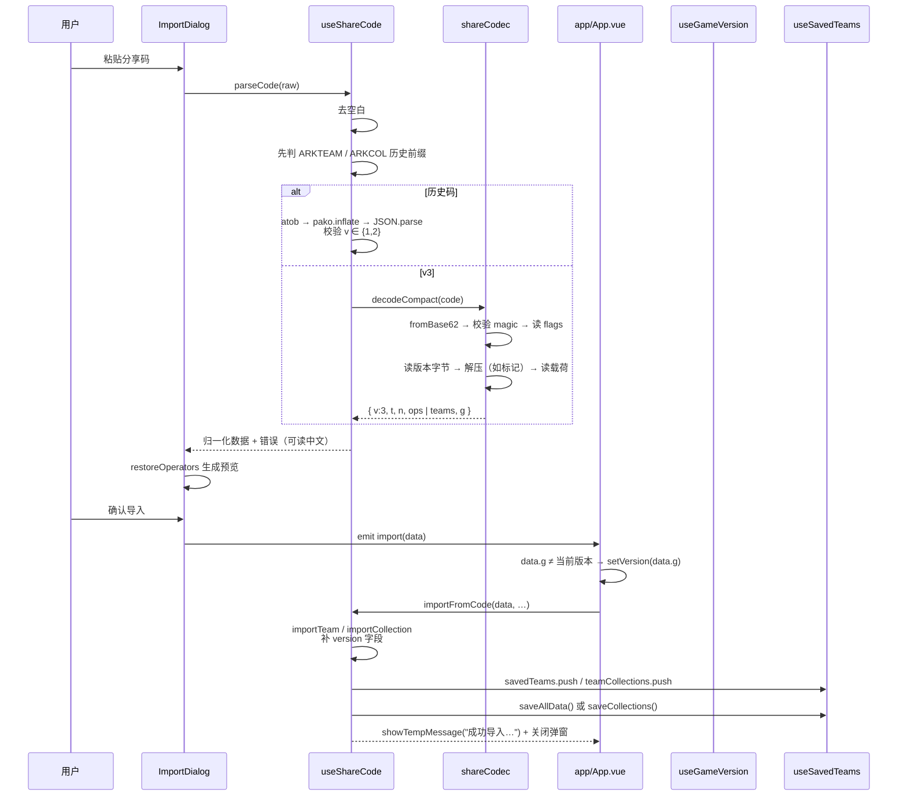
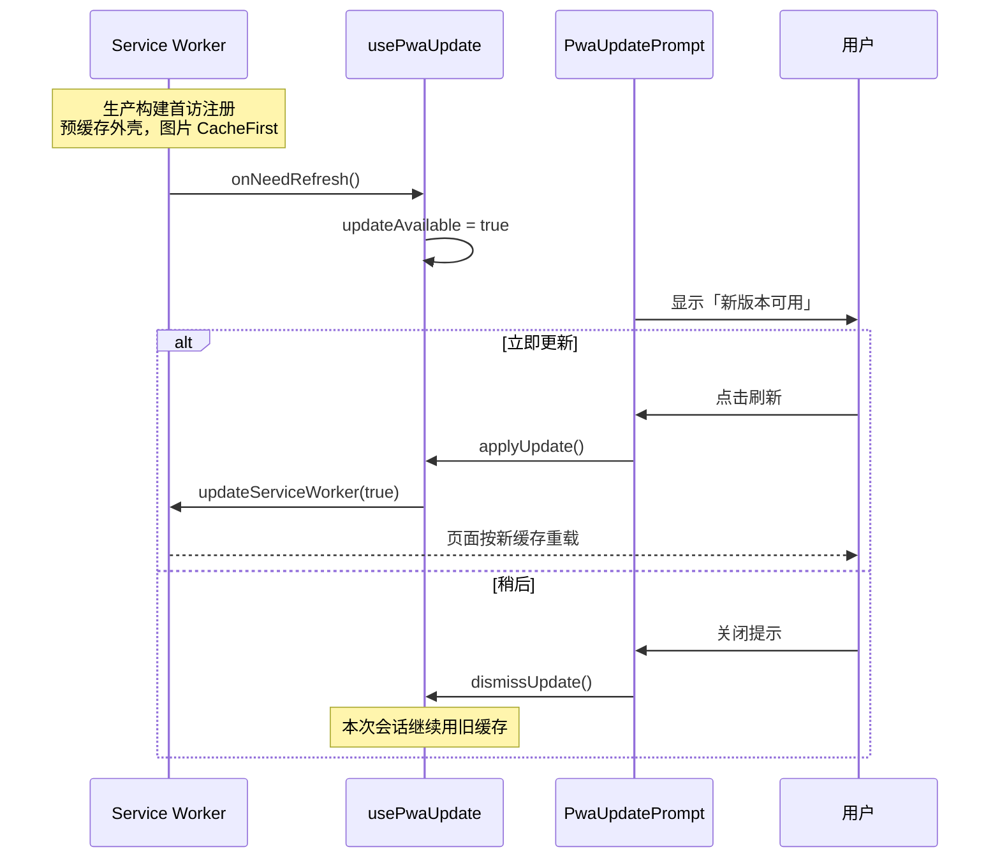

# 关键业务流程

每个流程都标出「谁触发 → 经过哪些 composable → 落到哪里」。视图层只负责触发与呈现，真正的规则都在领域层。

---

## 1. 应用启动

要点：版本在**模块加载期**就已读出（模块级 `ref`），因此首帧渲染就是用用户上次选择的版本，不会出现「先显示盟约版再跳规程版」的闪烁。

---

## 2. 版本切换

设计意图：**没有「切换版本」的显式刷新动作**。所有派生数据都是 `computed`，依赖 `currentVersionId` 自动失效重算；唯一需要手工处理的是「不该跨版本存在」的会话态——临时装备池与装备标签页。

---

## 3. 添加干员与盟约统计

统计是全应用最核心的计算，链路如下：

关键规则：

- **同名干员只计一次**：`seen` 集合按 `name` 去重，编队里理论上不会出现重复，但导入数据可能带
- **调和加成在基础统计之后**：`调和` 自身人数达标时，所有人数 > 0 的核心盟约 +1；加成的 +1 不会再次触发其他加成（单次传递）
- **变形同构体算在 `getEffectiveOperatorCovenants` 里**，因此它带来的成员可以正常触发激活与进阶；同时单独记到 `morphCovCounts`，让界面能标注「这 3 人里有 1 人来自装备」

---

## 4. 装备装配

装备有三条入口，最终都收敛到 `TeamPanel.applyEquipment`：

为什么用自定义 MIME：干员排序（`vue-draggable-plus`）也会写 `text/plain`，若按文本回退会把干员名当装备名，触发「装备槽已满」的误报。`readEquipmentDrag` 只认 `application/x-arknights-equipment`。

装备写入后，盟约统计自动重算（`team` 变了 → `useCovenantStats` 的 computed 失效），因此**变形同构体的加成不需要额外同步逻辑**。

---

## 5. 保存与加载编队

加载：

---

## 6. 生成分享码

---

## 7. 导入分享码

容错策略（都在这一层收口）：

| 情况 | 处理 |
| --- | --- |
| 码里带换行 / 空格 | `parseCode` 先 `replace(/\s+/g, "")` |
| Base62 含非法字符 | 抛「分享码包含非法字符」 |
| 载荷被截断 | 抛「分享码数据不完整」 |
| varint 溢出 | 抛「分享码数据损坏」 |
| 下标超出当前码表 | 抛「分享码来自更新的版本，请刷新页面后再导入」 |
| 干员名查不到 | `restoreOperators` 跳过并 `console.warn`，不阻断整份导入 |
| 结果为空 | 抛「编队中没有有效干员」/「合集中没有有效编队」 |

---

## 8. PWA 更新

选 `prompt` 而不选 `autoUpdate`：正在编辑的编队只在内存里，强制刷新会直接丢。宁可让用户带着旧版本用到他愿意刷新为止。

---

## 状态变更总表

| 触发 | 变更的状态 | 是否落盘 |
| --- | --- | --- |
| 点击干员 | `team` | 否 |
| 拖拽排序 | `team` | 否 |
| 点选 / 拖放装备 | `team[i].equipments` | 否 |
| 点击装备入池 | `stagedEquipments`、`selectedEquipment` | 否 |
| 保存编队 | `savedTeams` / `teamCollections` | 是 |
| 删除编队 | 同上（空合集连带删除） | 是 |
| 移动到合集 | `savedTeams` + `teamCollections` | 是（两个键） |
| 切换版本 | `currentVersionId` | 是 |
| 筛选 / Ban | 组件局部状态 | 部分（视图模式、折叠） |
| 自选干员 | `selectedSelfOperators` | 是 |
| 导入分享码 | 已保存编队 / 合集 + 可能切版本 | 是 |
