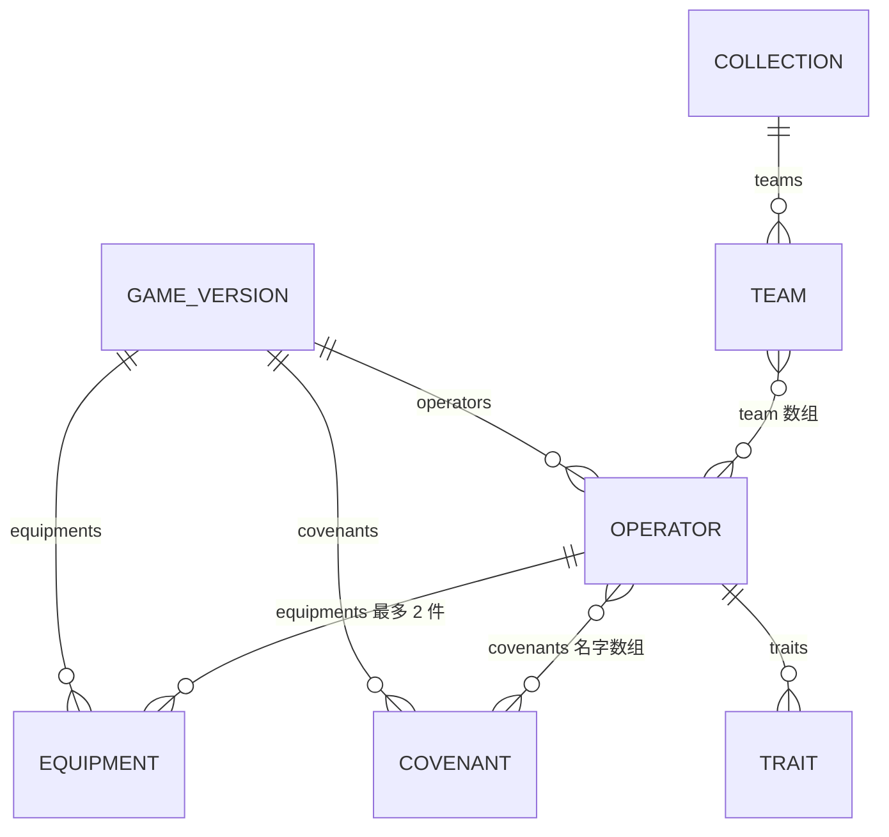

# 核心数据结构

数据分三类：**打包进产物的静态数据**（`src/data/*.json`）、**浏览器内的用户数据**（`localStorage`）、**跨设备传输的分享码载荷**。三者字段风格不同——静态数据追求可读，用户数据追求简单，分享码追求短——理解这一点再改字段就不容易踩兼容坑。



---

## 一、静态数据

### 1. 版本注册项（`versions.js` → `GAME_VERSIONS[]`）

| 字段 | 类型 | 必填 | 说明 |
| --- | --- | --- | --- |
| `id` | `string` | 是 | 版本标识，同时是存储值与分享码版本字节的依据：`mengyue` / `guicheng` |
| `label` | `string` | 是 | 完整名称，用于按钮与提示：`卫戍协议·规程` |
| `shortLabel` | `string` | 是 | 短名，用于 `document.title`：`规程` |
| `badge` | `string` | 否 | 按钮角标，如 `NEW` |
| `desc` | `string` | 是 | 副标题文案，说明赛季与特色 |
| `source` | `string` | 是 | 数据来源链接（PRTS） |
| `selfOperatorStrategy` | `"direct" \| "faction"` | 是 | 自选干员盟约推断策略，见下文 |
| `banStrategy` | `"covenant" \| "faction"` | 否 | Ban 命中策略，缺省按 `covenant` |
| `covenants` | `Record<string, Covenant>` | 是 | 该版本盟约表，键为盟约名 |
| `operators` | `Record<string, Operator>` | 是 | 该版本干员表，键为干员名 |
| `equipments` | `Record<string, Equipment>` | 是 | 该版本装备表；盟约版为空对象 `{}` |

`selfOperatorStrategy` 的差异：

- `direct`（盟约版）：直接采用 `selfOperators.json` 里登记的核心盟约
- `faction`（规程版）：用登记盟约去交集当前版本核心盟约；结果为空时归为 `协防干员`

`banStrategy` 的差异：

- `covenant`（缺省）：干员的**全部**盟约都被 Ban 才隐藏
- `faction`（规程版）：命中任一被 Ban 的核心盟约即隐藏；附加盟约仍按「全部被 Ban」

### 2. 盟约（`covenants*.json`）

```json
{
  "炎": {
    "name": "炎",
    "group": "core",
    "activateCount": 3,
    "effects": [
      {
        "type": "基础效果",
        "description": "【炎】干员攻击力+(23+0.9×层数)%"
      },
      {
        "type": "在场效果",
        "condition": "在场6名不同的【炎】干员",
        "description": "战斗开始时，【炎】干员每次攻击时造成攻击力6%的随机元素损伤……"
      }
    ]
  }
}
```

| 字段 | 类型 | 说明 |
| --- | --- | --- |
| `name` | `string` | 盟约名，与键一致；也是干员 `covenants` 里的引用值 |
| `group` | `"core" \| "additional"` | 核心盟约（阵营）/ 附加盟约。阵营与盟约两组筛选项都由它推导，不硬编码列表 |
| `activateCount` | `number` | 激活所需人数 |
| `effects` | `Effect[]` | 效果列表，可含多条 |
| ~~`operators`~~ | — | **P5 已删除**。它曾是 PRTS 页面的成员列表，与干员的 `covenants` 是同一事实的两份拷贝，已漂移 49 处且运行时 0 读取 |

`Effect` 字段：

| 字段 | 类型 | 说明 |
| --- | --- | --- |
| `type` | `string` | 效果类别，现有 7 种：`基础效果` / `在场效果` / `叠加效果` / `层数效果` / `周期效果` / `条件效果` / `特殊机制` |
| `condition` | `string` | 可选。触发条件，如 `在场6名不同的【炎】干员`、`每叠加25层` |
| `description` | `string` | 效果正文，`×层数` 为占位写法，不做数值计算 |

**进阶等级是从 `condition` 反推的**：`features/covenants/composables/useCovenantStats.js` 用正则 `/^在场(\d+)名不同/` 提取阈值，按当前人数满足几个阈值即为几级。因此该句式属于**隐性契约**——改文案时若破坏句式，进阶展示会静默失效。

### 3. 干员（`operators*.json`）

```json
{
  "卡达": {
    "tier": "Ⅰ",
    "covenants": ["奥术"],
    "traits": [
      {
        "type": "持续叠加",
        "trigger": "休整期结束时",
        "description": "使已激活的【奥术】层数+1",
        "upgraded": "使已激活的【奥术】层数+2"
      }
    ]
  }
}
```

| 字段 | 类型 | 说明 |
| --- | --- | --- |
| `tier` | `string` | 阶数，罗马数字 `Ⅰ`~`Ⅵ`；空串表示无阶数（自选干员常见） |
| `covenants` | `string[]` | 所属盟约名列表，值必须能在同版本 `covenants` 中找到 |
| `traits` | `Trait[]` | 特质列表，可为空数组 |

`Trait` 字段：

| 字段 | 类型 | 说明 |
| --- | --- | --- |
| `type` | `string` | 特质类别：`作战能力` / `整备能力` / `单次叠加` / `持续叠加` / `特异化` |
| `trigger` | `string` | 可选。触发时机，如 `休整期结束时`、`战斗中` |
| `description` | `string` | 效果正文。正文里 `<战斗中>`、`<获得时>` 形式的条件标记会在浮层渲染成行内标签 |
| `upgraded` | `string` | 可选。进阶（叠加到更高层数）后的效果文本 |

筛选区的「特质类型」「触发时机」选项都是从数据里 `Set` 去重动态推导的，新增取值无需改组件。

### 4. 装备（`equipment.guicheng.json`）

```json
{
  "不退者卫护系统": {
    "tier": 6,
    "price": 6,
    "base": "免疫晕眩、冻结等特殊状态，阻挡数+2……",
    "advanced": "免疫晕眩、冻结等特殊状态，阻挡数+2……",
    "desc": "“愿你成为在战场上，直至最后也能骄傲站立着的传奇。”",
    "parts": ["不退者之盾", "不退者力场"]
  }
}
```

| 字段 | 类型 | 说明 |
| --- | --- | --- |
| `tier` | `number` | 等阶 1–6，列表按它排序 |
| `price` | `number` | 售价 |
| `base` | `string` | 基础效果 |
| `advanced` | `string` | 进阶效果 |
| `desc` | `string` | 风味文本，可含换行 |
| `morph` | `string` | 可选。变形同构体指向的盟约名（19 件） |
| `combo` | `string` | 可选。组合装原料指针（10 件） |
| `parts` | `string[]` | 可选。合成结果所需的原料清单（5 件） |

`combo` 与 `parts` 是同一关系的两侧：原料件写 `combo: 成品名`，成品件写 `parts: [原料…]`。运行时只用 `parts` 做「是否凑齐」判定。

### 5. 自选干员（`selfOperators.json`）

```json
{ "陈": { "tier": "", "covenants": ["炎"], "traits": [] } }
```

结构与 `operators*.json` 的条目**完全一致**，但它是**跨版本的补丁层**：这些干员不在任一版本的干员池里，出战时通过 `isSelfOperator: true` 标记，盟约与阶数按当前版本的 `selfOperatorStrategy` 推断。五阶、六阶各最多选 2 名（由 `features/roster/components/SelfOperatorDialog.vue` 约束）。

### 6. 码表（`opCodebook.json` / `equipCodebook.json`）

```json
["隐现", "角峰", "惊蛰", "..."]
```

纯字符串数组。**下标即协议码值**，因此只允许末尾追加（`npm run codebook` 负责这件事）。当前 200 条干员名、70 条装备名，覆盖两版本与自选干员的全部名字。

---

## 二、用户数据（运行时对象）

### 1. 编队中的干员

| 字段 | 类型 | 说明 |
| --- | --- | --- |
| `id` | `number \| string` | 列表键。干员池用下标，自选干员用 `self-<tier>-<name>-<index>` |
| `name` | `string` | 干员名，所有数据关联的唯一依据 |
| `avatar` | `string` | 头像 URL，由 `getAvatarUrl(name)` 生成 |
| `tier` | `string` | 可选。仅自选干员需要显式带，其余从数据表查 |
| `isSelfOperator` | `boolean` | 可选。自选干员标记，跨版本校验时跳过 |
| `equipments` | `string[]` | 可选。已装备名列表，长度 ≤ 2，空槽不占位 |

### 2. 已保存编队 `SavedTeam`

| 字段 | 类型 | 说明 |
| --- | --- | --- |
| `name` | `string` | 编队名 |
| `team` | `TeamOperator[]` | 干员数组（结构同上） |
| `createTime` | `string` | `toLocaleString()` 结果，仅展示 |
| `version` | `string` | 可选。所属版本 id，**缺省视为 `mengyue`**（兼容历史存档） |
| `teamIndex` / `collectionName` | `number` / `string` | 仅编辑弹窗临时注入，不落库。合集一律用**名字**定位，索引会随合集增删漂移 |

### 3. 合集 `TeamCollection`

| 字段 | 类型 | 说明 |
| --- | --- | --- |
| `name` | `string` | 合集名，也是「移动到合集」的匹配键 |
| `teams` | `SavedTeam[]` | 合集内编队 |
| `expanded` | `boolean` | UI 展开态，**保存时会被剥离**，刷新后统一置 `true` |
| `version` | `string` | 可选。新建合集时从首个编队继承 |

合集为空时会被自动删除（`deleteTeam` 内联处理），避免残留空壳。

### 4. 持久化键

键名集中在 `src/infrastructure/storage/keys.ts`（`STORAGE_KEYS`），**值已冻结**：改名等于老用户存档全丢，只允许新增键。读写统一经 `localStore.ts`，仓储层再按用途分组。

| 键 | 内容 | 仓储 / 写入方 |
| --- | --- | --- |
| `arknights_saved_teams` | `SavedTeam[]`（未归类） | `teamsRepository.saveTeams` ← `useSavedTeams` |
| `arknights_team_collections` | `TeamCollection[]`（已剥离 `expanded`） | `teamsRepository.saveCollections` ← `useSavedTeams` |
| `arknights_game_version` | 版本 id 字符串 | `preferencesRepository.setVersionId` ← `useGameVersion` |
| `arknights_selected_self_operators` | `{ name, tier, avatar, isSelfOperator }[]` | `preferencesRepository.setSelfOperators` ← `useSelfOperators` |
| `arknights_pool_filter_view` | `icon` \| `text` | `preferencesRepository.setFilterView` ← `usePoolFilters` |
| `arknights_pool_filter_collapsed` | `"1"` \| `"0"` | `preferencesRepository.setFilterCollapsed` ← `usePoolFilters` |

约定：

- **每次访问（读或写）各自 try/catch**，解析失败回退空数组或默认值，不因单条脏数据整页白屏；写入失败（配额满 / 隐私模式）只告警，不打断操作。
- 存档是合法 JSON 但不是数组（被手动改过）时，按「读不出来」处理。
- 页面渲染之外的代码不再出现 `localStorage`：`grep -rn "localStorage" src | grep -v infrastructure` 应只剩 `tests/`。
- 当前没有 `schemaVersion` 字段：P3 未新增存档字段，等真需要迁移时再加，避免空转。

---

## 三、分享码载荷

### 1. v3 二进制布局（当前）

整体为 `A` + Base62，解码后为字节流：

```text
头部  1B   0xC0 | 类型      （0xd0 | 类型 表示携带装备字段）
标志  1B   bit0 = 已 deflate，bit1 = 带版本号
版本  1B   可选，VERSION_CODES 下标（0 = mengyue，1 = guicheng）
载荷  ...  见下表
```

| 类型 | 值 | 载荷结构 |
| --- | --- | --- |
| 单编队 | `1` | `name(string)` → `count(varint)` → `Operator…` |
| 合集 | `2` | `name(string)` → `teamCount(varint)` → `Team…` |
| 全量 | `3` | **已废弃**：P1 删除生成与 `type=3` 解码分支（从未上线 UI，也没有历史码）。原结构为 `name(string)` → `Team…` → `collectionCount(varint)` → `{name, Team…}…` |

- `string` = `varint` 长度 + UTF-8 字节
- `Team` = `name(string)` → `opCount(varint)` → `Operator…`
- `Operator` = `varint(ref << 1 | 自选标记)` → 自选时跟 1B 阶数码 → 带装备时跟 `equipCount(varint)` + 装备引用
- `ref === 8191`（`ESCAPE_REF`）表示码表外，随后写名字字面量
- 载荷长度 > 72 字节才 deflate（短码压缩反而更胖）

**magic 的作用**：`0xd0` 专门表示「带装备」。旧解码器读到未知 magic 直接判无效，而不是把装备字节误读成干员下标——这是格式演进时唯一安全的做法。

### 2. 解码后的统一对象

`parseCode()` 把 v1/v2/v3 都归一到同一形状，上层无需区分版本：

```js
{
  v: 3,
  t: "team" | "collection" | "full",
  type: "team",            // 与 t 相同的别名，历史遗留
  n: "队名",
  ops: ["隐现", { n: "陈", t: "Ⅵ", s: 1, e: ["维式重锤"] }],
  teams: [{ n: "队名", ops: [...] }],
  collections: [{ n: "合集名", teams: [...] }],
  g: "guicheng",           // 可选，版本 id
}
```

`ops` 元素是**联合类型**：字符串表示普通干员，对象表示带附加信息的干员（`n` 名字 / `t` 阶数 / `s` 自选标记 / `e` 装备）。`restoreOperators()` 负责把它还原成运行时干员对象。

### 3. v1 / v2 历史格式

`ARKTEAM` / `ARKCOL` 前缀 + Base64(deflate(JSON))，JSON 形如：

```json
{
  "v": 2,
  "t": "collection",
  "n": "合集名",
  "teams": [{ "n": "队名", "ops": [{ "n": "隐现", "t": "", "s": 0 }] }]
}
```

只读不写。新码一律 v3。解析顺序上必须先判断历史前缀，因为 `ARKTEAM` 也以 `A` 开头。

---

## 四、不变量

改动数据结构时，以下断言必须继续成立：

1. `operators[x].covenants` 中的每个名字都能在同版本 `covenants` 里找到（否则盟约统计会漏计）
2. 每个版本的 `covenants` 至少包含一个 `group: "core"`，否则阵营筛选为空
3. 自选干员的 `tier` 只能是 `Ⅴ` 或 `Ⅵ`，且每个阶数最多 2 名
4. 干员 `equipments` 长度 ≤ `EQUIPMENT_SLOT_COUNT`（2），且不重复
5. `morph` 指向的盟约必须存在于**当前版本**，否则该加成被忽略（规程版没有「拉特兰」这类盟约）
6. 码表只追加，`VERSION_CODES` 只追加
7. 任何存档缺少 `version` 时按 `mengyue` 处理，不允许抛错
8. 分享码解析失败必须是可读的中文错误（`分享码数据不完整` 之类），不得抛出底层异常

## 五、字段演进清单

| 改了什么 | 还要动哪里 |
| --- | --- |
| 干员新增 `traits` 类别 | 无需改代码，筛选选项自动推导；建议补测试断言存在该类别 |
| 盟约新增 `effects.type` | 检查 `CovenantTooltip.vue` 的 `typeClass` 映射，未命中会落到默认样式 |
| 干员新增字段并要进分享码 | `shareCodec.ts` 的 `writeOperator` / `readOperator` + 开新 magic（不能复用 `0xc0`） |
| 编队新增字段并要落库 | `useSavedTeams.js` 的 `saveTeam` / `updateTeam` + 兼容旧存档的读取兜底 |
| 新增持久化键 | 本节表格 + [overview.md](overview.md) 的分层规则（写存储只能经 `infrastructure/storage`，由 composable 调用） |
