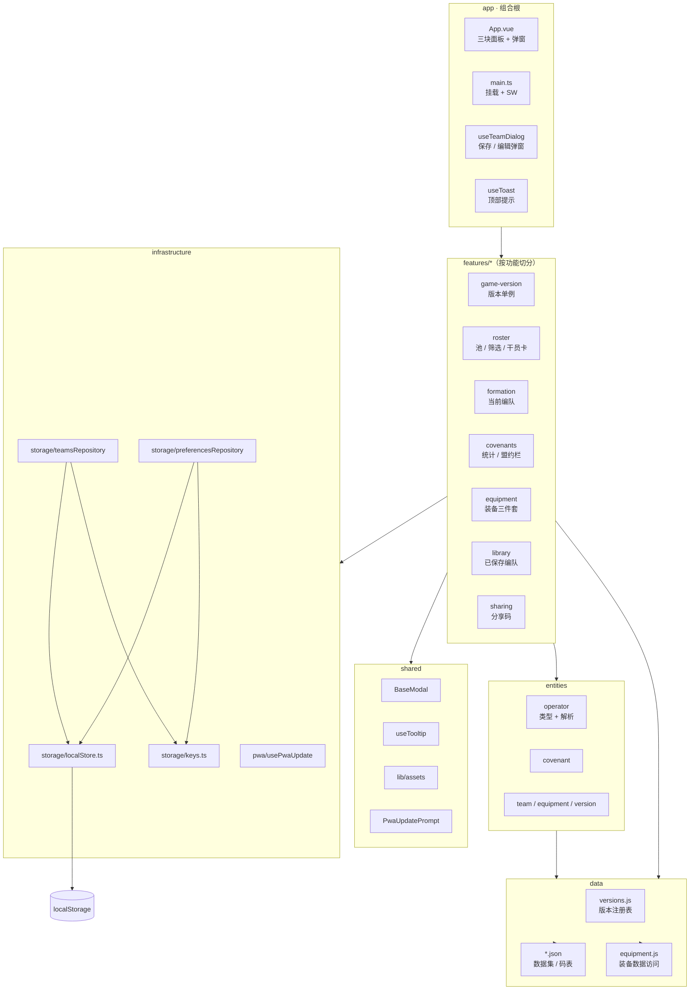
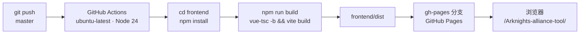

# 总体架构

## 定位

卫戍协议练功房是一个**纯前端单页应用**：没有后端、没有账号体系、没有网络请求。所有业务数据来自打包进产物的 JSON，用户产生的数据（编队、合集、偏好）只存在浏览器 `localStorage`，跨设备交流靠自研分享码。

这个约束不是妥协的产物，而是刻意的取舍——工具的使用场景是「对着一局游戏反复试阵容」，本地运算零延迟，也不需要为一份静态数据维护服务器。

## 运行时形态

| 维度 | 现状 |
| --- | --- |
| 部署形态 | GitHub Pages 静态站点，子路径 `/Arknights-alliance-tool/` |
| 应用类型 | 单页应用，**无 vue-router**，三块面板靠标签页切换 |
| 服务端 | 无。没有任何 `fetch` 业务接口 |
| 持久化 | `localStorage`（6 个键，见 [data-model.md](data-model.md#持久化键)） |
| 离线能力 | 生产构建注册 Service Worker，外壳预缓存 + 图片运行时缓存 |
| 首次加载体积 | 应用外壳 gzip 后数百 KB 量级，干员头像 345 张走按需加载 |

## 分层

### 依赖规则

1. **视图层不碰数据文件**。组件通过 `useGameVersion()` 拿到当前版本的 `covenants` / `operators`，或调用 `data/versions.js` 的解析函数；不 `import` 任何 `*.json`。已知例外只有 `features/roster/components/SelfOperatorDialog.vue` 直接读 `selfOperators.json`（自选池候选列表），待收敛到访问器。
2. **视图层与 composable 都不碰 `localStorage`**。持久化统一走 `src/infrastructure/storage`：composable 调仓储（`teamsRepository` / `preferencesRepository`），仓储调 `localStore`，键名只出现在 `keys.ts`。P3 之后 `src` 内除 `infrastructure/` 只剩 `tests/` 还会出现这个词。
3. **领域层不碰 DOM**。`useTraitTooltip` / `useCovenantTooltip` 持有的是浮层的坐标与内容状态，真正挂载由组件 `teleport` 到 `body` 完成。
4. **每个 feature 的 `domain/` 是纯函数区**。统计、筛选、Ban、上限、装备规则、分享码映射都在这里，不 `import vue`、不读写 `localStorage`、不调 `alert`。P5 之后 `src/domain/` 已不存在，领域文件全部在 `src/features/*/domain/`；`src/tests/domainBoundaries.spec.js` 递归扫描目录名 `domain` 后读源码校验。
5. **`entities/` 是实体类型与数据访问器，不是第二套领域层**。它允许 `import data`（访问器本来就要读数据集），但不放规则、不碰 Vue、不碰存储。`data` 不反向 import `entities`。
6. **`shared` 与 `infrastructure` 不依赖 `features`**。`shared` 放无业务含义的通用件（弹窗骨架、浮层控制器、图片地址），`infrastructure` 放与浏览器打交道的东西（存储、Service Worker）。
7. **唯一组合根是 `app/App.vue`**。所有 composable 在此实例化，结果通过 props 下发、通过 emits 上抛；需要写别的模块的状态时用回调注入（如 `importFromCode(data, { addTeam })`），不传 ref 进去 push。
8. **基础设施层不判断数据合法性**。它只回答「怎么存取」——版本 id 是否注册、自选干员阶数是否有效，仍是 composable 的判断。
9. **composable 不弹对话框**。满员、空编队这类拒绝用返回值表达（`addToTeam` / `openSaveTeamModal` 返回 `boolean`），提示文案与 `prompt` 询问留在视图层，这样 composable 可以在没有 DOM 的环境里直接测。
10. **features 之间通过 `index.ts` 收口**。跨 feature 与 `app/` 只能从 `@/features/<name>` 导入，由 `src/tests/featureBoundaries.spec.js` 扫源码强制；`domain/` 之间是唯一例外（纯规则直连 `features/<x>/domain/...`，避免把组件带进纯函数层的依赖图）。依赖方向是一条无环链：`game-version → equipment → covenants → roster → formation → library`。

## 关键设计决策

### 1. 版本注册表驱动，而非按版本 fork 代码

两个赛季的数据结构基本一致，差异集中在数据与少量规则（自选干员盟约推断、Ban 策略）。`versions.js` 用一个数组声明每个版本的 `covenants` / `operators` / `equipments` 与策略字段，业务代码只读 `version.*`，不写 `if (version === 'guicheng')`。

代价是策略字段会缓慢堆积（`selfOperatorStrategy`、`banStrategy`），但比复制一份组件树便宜得多。

### 2. 状态按生命周期切分，而不是按页面切分

没引入 Pinia：项目状态只有「会话级（当前编队、弹窗）」和「持久级（已保存编队、版本偏好）」两类，`ref` + 模块级单例足够。`useGameVersion` 是唯一真单例（模块作用域 `ref`），其余 composable 在 `App.vue` 中实例化一次后按需传参。

这样做的收益是数据流始终单向：`App.vue` → props → 子组件 → emits → `App.vue`。

### 3. 无路由

三块面板是同一屏内的标签页，切换不改变 URL，也不需要刷新后恢复。省掉 router 后首屏少一个依赖，也让移动端的滚动状态处理简单得多（没有路由切换要重置滚动位置的问题）。

代价：无法直接分享「某个面板」的链接——但分享的真实需求是编队内容，已由分享码覆盖。

### 4. 分享码自研二进制协议

文字分享码要在聊天软件里传递，长度直接决定体验。v1/v2 是 `JSON → deflate → base64`，一个 12 人编队 179 字符；v3 改为二进制 + 码表引用 + varint + Base62，同编队 40–50 字符。

代价是协议脆弱性：码表顺序即协议的一部分，因此有「码表只追加」的铁律和 `npm run codebook` 脚本兜底（见 [CONTRIBUTING.md](../docs/CONTRIBUTING.md#分享码兼容性铁律)）。

### 5. PWA 缓存：外壳预缓存，图片运行时缓存

干员头像共 14 MB / 345 张，全部预缓存会拖慢首装。策略是应用外壳（js/css/html/svg）预缓存保离线可用，`/resource/image/**` 排除预缓存改走 `CacheFirst`，上限 400 条、30 天过期、配额不足自动清理。

更新用 `prompt` 模式：发现新版本只弹提示，由用户决定何时刷新——直接 `autoUpdate` 会在用户编辑编队时强制刷新丢状态。

### 6. 移动端整页滚动，而非局部滚动

桌面端左右两栏各自 `overflow-y: auto`，视觉效果紧凑；触屏上这会形成嵌套滚动陷阱（手指落在侧栏只滚侧栏）。因此 `≤1024px` 时两栏同时 `overflow: visible`，页面回归单一滚动上下文，容器 `height: auto`。

## 构建与部署

- 工作流：`.github/workflows/deploy.yml`，仅 `master` 推送触发
- `base` 与 PWA 的 `scope` / `start_url` 都基于 `/Arknights-alliance-tool/`，三者必须一致
- 构建含 `vue-tsc -b` 类型检查，类型错误会阻断部署

## 质量保障

**218 条用例 / 25 个文件**（`npm run test:run`）+ `npm run knip` 零输出，覆盖重心在「最容易静默出错」的地方：

| 测试 | 位置 | 关注点 |
| --- | --- | --- |
| `shareCompat` / `useShareCode` | `src/tests` / `features/sharing` | v3 快照、旧码兼容、编解码往返 |
| `storageCompat` | `src/tests` | 旧存档逐字读回、键名不变、损坏回退 |
| `domainBoundaries` | `src/tests` | 领域层不碰 Vue / 存储 / 对话框 / 视图层 |
| `featureBoundaries` | `src/tests` | 跨 feature 只从 `index.ts` 导入 |
| `useToast` / `useShareDialogs` | `app/tests` / `features/sharing` | 提示计时器不互相打断、空分享码不弹空窗 |
| `app.smoke` | `src/tests` | 整体渲染与版本切换冒烟 |
| `domain.*` | 各 feature | 统计、筛选、上限、装备、分享码映射的纯函数 |
| `poolFilter` / `mobilePool` | `features/roster` | 筛选与 Ban 策略、移动端断点 |
| `traitTooltip` / `covenantTooltip` | roster / covenants | 浮层内容与版本联动 |
| `equipment` / `equipmentUi` | `features/equipment` | 装备池完整性、变形同构体、选择器与拖拽 |
| `collectionRefs` / `savedTeamsPanel` | `features/library` | 合集按名字定位、移动不误伤 |
| `gameVersion` | `features/game-version` | 两版本数据完整性、跨版本查找 |

没有 E2E：交互密集的拖拽场景用组件级测试覆盖，样式与布局问题靠人工在 `≤1024px` / `≤768px` 两档回归。

## 边界与非目标

明确不做的事，避免后续误判为缺陷：

- **不做对局记录 / 战绩统计**：没有数据源，也超出「配队工具」范围
- **不做多端同步**：需要账号与后端，与纯前端定位冲突；跨端交流用分享码
- **不做装备的自动最优解**：装备效果存在组合与场景依赖，工具只呈现事实
- **不抓取 PRTS**：数据为人工校对后落库，构建期不访问外网

## 扩展点

| 想做的事 | 落点 |
| --- | --- |
| 新增赛季 | `data/` 加数据集（`operators.<id>.json` / `covenants.<id>.json`）→ `versions.js` 注册 → `shareCodec.ts` 追加 `VERSION_CODES` |
| 新增装备 | `data/equipment.<id>.json` → `npm run codebook` → 补 `features/equipment/tests/equipment.spec.js` |
| 新增筛选维度 | `features/roster`：`usePoolFilters` 的状态 + `PoolFilters` 的控件 + `domain/filterOperators` 的匹配 |
| 新增分享内容 | `features/sharing/domain/shareCodec.ts` 开新 magic + 新 type，旧解码器判无效 |
| 新增统计规则 | `features/covenants/domain/covenantStats.ts`（纯函数 + 单测），再由 `useCovenantStats` 包成 computed |
