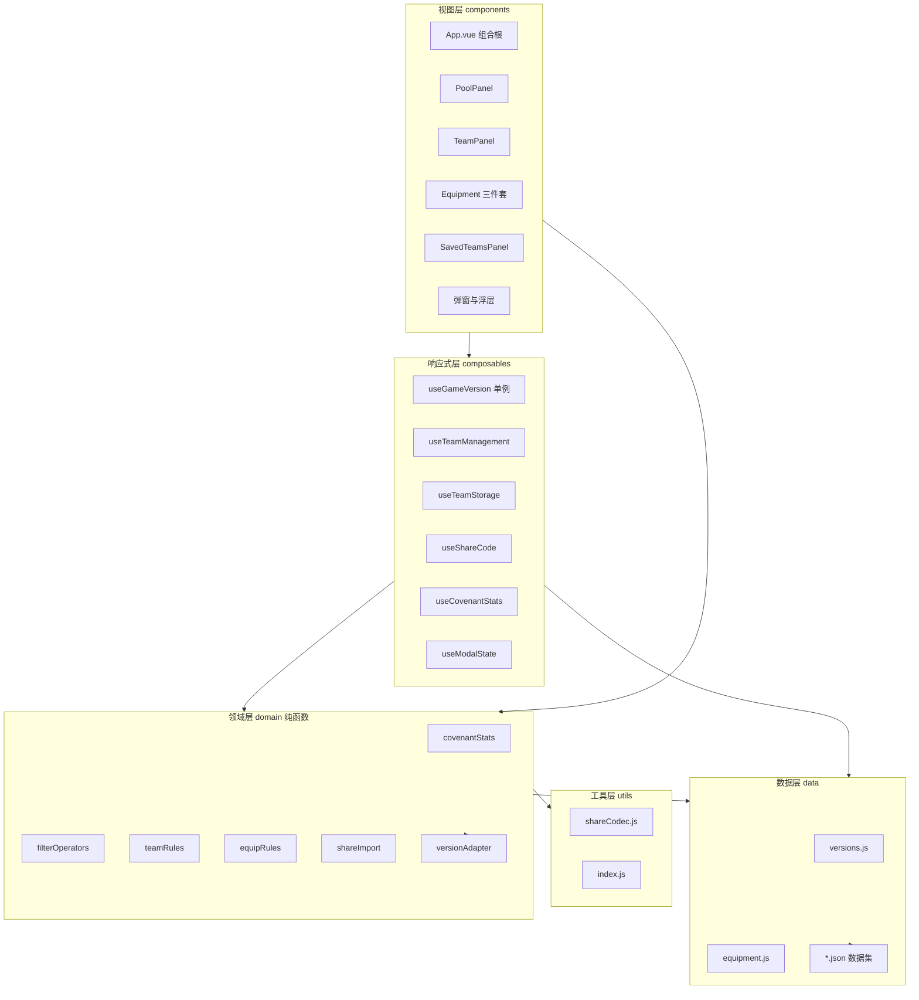
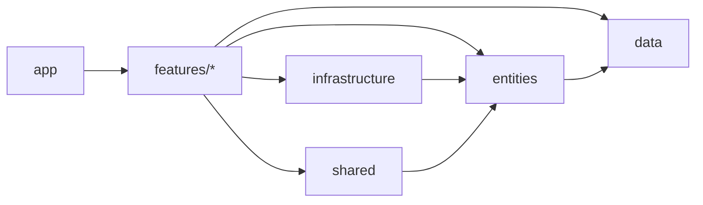

# 架构审计与重构计划

**已归档，不是待办清单。** P0–P5 六个阶段全部完成（2026-11-20），本文档只作为决策依据保留：
每阶段的证据、取舍与偏差都在这里，改代码前想查「当初为什么这么定」再看。
仍有未完成的事项时，见 [architecture/backlog.md](../../architecture/backlog.md)。

> 本文档基于对 46 个源文件的逐一阅读、脚本抽取的真实 import 图、以及针对数据一致性的脚本化核对，**不是**根据文件名或 README 推断。
>
> 状态：P0–P5 已完成；P5 的偏差与遗留项见第 10 节。
> 最后更新：2026-11-20

## 目录

- [1. 结论摘要](#1-结论摘要)
- [2. 已确认的前提](#2-已确认的前提)
- [3. 当前架构](#3-当前架构)
- [4. 问题清单与证据](#4-问题清单与证据)
- [5. 目标目录树](#5-目标目录树)
- [6. 迁移对照表](#6-迁移对照表)
- [7. 模块职责与依赖规则](#7-模块职责与依赖规则)
- [8. 数据模型改造建议](#8-数据模型改造建议)
- [9. 兼容性风险](#9-兼容性风险)
- [10. 分阶段计划](#10-分阶段计划)
- [11. 每阶段验收标准](#11-每阶段验收标准)
- [12. 不建议重构的部分](#12-不建议重构的部分)
- [13. 待确认事项](#13-待确认事项)

---

## 1. 结论摘要

项目规模：业务 + 视图约 7.9k 行（含 SFC 样式），数据 JSON 6.5k 行，测试 1.6k 行。**这是一个中等偏小的单页应用**，这个规模决定了重构的正确做法是「收敛职责 + 拆大文件」，而不是引入分层框架。

三条核心判断：

1. **依赖图本身是健康的**：对全部源文件做 DFS 环检测，**0 个循环依赖**；`data` 不反向依赖 `composables`，`equipment` 不依赖 `versions`。这是最有价值的资产，任何重构都必须保住。
2. **真正的债在「职责」而不在「结构」**：`PoolPanel.vue`（1355 行）与 `TeamPanel.vue`（816 行）各自承担 6 类职责；业务规则（Ban 策略、上限截断、morph 判定）埋在模板组件与 composable 里，只能靠 mount 组件间接测试。
3. **Vue 与 TypeScript 的覆盖率被高估**：17 个 SFC 全是 `<script setup>`（无 `lang="ts"`），`vue-tsc` 实际只校验 2 个 `.ts` 文件；没有 lint、没有覆盖率统计。

因此计划按「先立护栏 → 逻辑下沉 → 拆组件 → 收敛基础设施 → 迁目录 → 清理」推进，每阶段独立可合并、可回滚、测试全绿。

---

## 2. 已确认的前提

审计阶段提出的 5 个不确定项已确认：

| 问题 | 结论 | 对计划的影响 |
| --- | --- | --- |
| 「对局模拟器」「策略轴」在哪 | **只是规划中的功能**，当前仓库不存在 | 本次不虚构该模块；未来单列 `features/simulator`，且需要不可变编队快照，不复用 `useTeamManagement` 的可变 `team` |
| 盟约版（mengyue）是否下线 | **保留**（历史赛季） | `resolveTeamVersionId` 仍以 mengyue 为缺省，行为不变；若将来下线，只需改 `domain/teamRules.ts` 一处 |
| 是否需要兼容真实用户存档 | **线上无用户数据** | 存档迁移函数可以简化为「读旧写新」，不必为未知脏数据写防御分支；但键名仍然冻结 |
| 全量导出（full / type=3） | **删除** | P1 已删 `encodeFull`、`generateFullCode`、`ARKFULL` 前缀、`type=3` 解码分支（从未上线 UI，无历史码） |
| 是否接受 `.ts` 渐进 | **接受** | `src/domain/` 直接用 `.ts`；其余保持 `.js`，`.vue` 暂不加 `lang="ts"` |

---

## 3. 当前架构

### 3.1 分层与依赖



环检测结论：**0 个循环依赖**（脚本对全部源文件做 DFS）。`domain/versionAdapter.ts` 是 `domain → data` 的唯一入口，P4 拆分 `versions.js` 时只需改这一处。

### 3.2 代码规模

| 层 | 位置 | 审计时 | P2 后 | 说明 |
| --- | --- | --- | --- | --- |
| 视图 | `src/components/*.vue` | 6279 行 / 16 个 | **6228 行 / 23 个**（+ `filter-controls.css` 91 行） | 多出 7 个文件而总行数反降 51 行：`.op-unit` 与筛选外观各去重一份 |
| 组合根 | `src/App.vue` | 650 行 | 659 行 | script 277 行；P3 会删 9 个未用绑定 |
| 响应式 | `src/composables/*` | 约 940 行 / 10 个 | **1220 行 / 13 个** | 新增 `usePoolFilters` / `useSelfOperators` / `useTooltip`；`useCovenantStats` 仍 51 行 |
| 领域 | `src/domain/*.ts` | — | 1090 行 / 7 个 | P1 新增，P2 未改动 |
| 数据 | `src/data/*` | 6479 行 | 6415 行 | 6.4k 行是人工录入的 JSON |
| 测试 | `src/tests/*.spec.js` | 11 个 / 87 个用例 | **17 个 / 186 个用例** | 2607 行 |

---

## 4. 问题清单与证据

### 4.1 已完成（P0 / P1 / P2 / P3 / P4 / P5）

| # | 问题 | 处理方式 |
| --- | --- | --- |
| S1 | `PoolPanel` 承担 6 类职责（搜索筛选 / 三态 Ban / 自选干员 / 移动端折叠 / 视图切换 / 拖拽源） | 规则下沉到 `domain/filterOperators.ts`（P1）；模板拆成 `PoolFilters` / `CovenantFilterRow` / `OperatorCard`，自选干员拆到 `useSelfOperators`（P2，1355 → 418 行） |
| S2 | `TeamPanel` 同时管编队编辑、跨版本校验、装备三条入口、盟约展示 | 规则下沉到 `domain/teamRules.ts` + `domain/equipRules.ts`（P1）；模板拆成 `TeamHeader` / `OperatorSlot` / `ActiveEffectsList`（P2，816 → 367 行） |
| S3 | `App.vue` 解构了 13 个从未使用的绑定 | P5 删完剩余 9 个；同时删掉 `useModalState` 里对应的 5 个死 ref |
| S6 | `hasEquipmentPool` 双实现 | `TeamPanel` 改用 `domain/equipRules.hasEquipmentPool` |
| S7 | `useTeamStorage.saveTeam(teamData, team, …)` 的 `team` 参数从未使用 | 已删除该参数，`saveTeam` / `updateTeam` 统一从 `teamData.team` 取值 |
| S8 | `generateFullCode` 是死代码 | 全量导出整条链路已删除（含 `encodeFull` / `type=3` 解码） |
| F1 | `importFromCode` 8 个位置参数并直接 push 别人的 ref | 改为 `(data, { versionId, addTeam, addCollection, notify, close })`，落库归 `App.vue` |
| F3 | 盟约统计把同一编队扫两遍、每名干员重复解析 | `computeCovenantStats` 单次遍历同时算原始人数与装备贡献 |
| T1 | `mobilePool.spec` 是假绿 | 桩改为「查询串匹配才返回 matches」，并直接断言组件查询的断点 |
| T2 | 数据规模断言写死（143 / 113 / 19） | 改为从数据推导 + 结构性断言 |
| S12 | 无 lint、无覆盖率 | ESLint 9（扁平配置）+ Prettier + `vitest --coverage` |
| D4 | 「缺省版本 = mengyue」散落 5 处 | 收口为 `domain/teamRules.resolveTeamVersionId`，`SavedTeamsPanel` / `App.vue` 已改；`versions.js` 与 `useGameVersion.js` 的内部回退保留（语义不同） |
| S1' | `PoolPanel` 模板 324 行挤着筛选面板、摘要、折叠条、网格 | 模板 324 → 79 行；筛选面板拆成 `PoolFilters` + `CovenantFilterRow`，卡片拆成 `OperatorCard` |
| S2' | `TeamPanel` 模板 169 行混装 header / 盟约条 / 网格 / 插槽 / 选择器 / 效果列表 | 模板 169 → 70 行；header、槽位、效果列表各自成组件，`slot name="staging"` 与 Sortable 参数原样保留 |
| S4 | `.op-unit` 两处各写一遍且不一致（75px / 78px） | 合并到 `OperatorCard.vue` 一处，统一 75px；`grep -c "\.op-unit {"` 全仓 = 1 |
| S5 | 两个 tooltip composable 约 95% 重复 | 抽 `useTooltip.js` 的 `createTooltip()`；两个 composable 只剩「浮层装什么」，共 122 行（原 211 行） |
| S9 | 同一 localStorage 键多处分散写入 | P3 收口：6 个键只在 `infrastructure/storage/keys.ts` 定义，写入全部经 `localStore` + 仓储，`src` 内已无散落调用 |
| S10 | composable 直接读写 3 个持久化键 | P3 收口到 `preferencesRepository`，`useGameVersion` / `usePoolFilters` / `useSelfOperators` 内已无存储细节 |
| F2 | 领域层 / composable 直接 `alert` | P3 改为返回值（`addToTeam` / `openSaveTeamModal` 返回 `false`），提示与 `prompt` 归视图层 |
| D5 | 合集用索引引用，重排即失效 | P3 改为合计名 + `teamIndex`；顺带修了三个真实缺陷（见 P3 偏差） |
| S14 | 顶层按文件类型平铺（`components/` `composables/` `domain/` `utils/`），改一个功能要跨 4 个目录找文件 | P4 按功能重组为 `app/` + `features/*` + `shared/` + `infrastructure/`，测试跟着功能走；只移动与改 import，逻辑零改动 |
| D6 | `data/equipment.js` 既读数据又 re-export 规则 | P4 删掉 re-export，调用方直连 `features/equipment/domain/equipRules` |
| D7 | 数据集命名不对称（`covenants.json` vs `covenants.guicheng.json`、`selfOp.json`） | P4 改为 `covenants.mengyue.json` / `operators.mengyue.json` / `selfOperators.json`，同步 `versions.js` 与 `gen-codebook.mjs` |
| D1 | 盟约 ↔ 干员双向引用已漂移 | P5 删掉 `covenant.operators`，从根上消掉第二份拷贝；干员归属只保留 `operator.covenants` |
| D2 | `covenant.operators` 无运行时读取 | P5 删除两个 JSON 共 49 处，`gen-codebook` 输出「无新增」 |
| S15 | `useModalState` 一个 96 行 / 21 项的大对象同时服务三个弹窗 | P5 拆成 `app/useTeamDialog` + `features/sharing/useShareDialogs` + `app/useToast` |
| S16 | features 之间 26 条深引，内部结构成了事实 API | P5 每个 feature 加 `index.ts`，跨 feature 与 `app/` 只走桶；`featureBoundaries.spec.js` 强制 |
| S17 | 导出面无检查，死函数与死导出靠人工发现 | P5 引入 `knip`，清到 0 输出；`npm run knip` 可回归 |

### 4.2 待处理

| # | 问题 | 证据 | 处理阶段 |
| --- | --- | --- | --- |
| S13 | 业务文案散在领域层与视图层 | 领域层 15 处 `throw new Error("<中文>")`，视图层 2 处原样透传 | **已完成**（`c0b5824` + `d5ef936`），见 `debt-plan.md` §1 |
| D3 | 干员实例 5 处各自拼装，字段不一致 | `PoolPanel`（两处）/ `useSelfOperators` / `SelfOperatorDialog` / `shareImport` | **已完成**（`794857e`），见 `debt-plan.md` §2 |
| S11 | 业务逻辑以 JS 为主，`vue-tsc` 只覆盖 TS 文件 | 实测 15 个 JS 源加 `@ts-check` 报 80 条；14 个 composable 与 24 个 SFC 仍是 JS | 未开工，见 `debt-plan.md` §3 |

三项的处置方案（含决策、步骤、验收、风险）见 **`docs/architecture/debt-plan.md`**。S13 与 D3 已按方案落地，S11 的阶段 0（补 `data/` 层类型）随时可起手。

---

## 5. 目标目录树

```text
frontend/src/
├─ app/
│  ├─ App.vue                          # 组合根：只装配，不写规则
│  ├─ main.ts
│  └─ styles/tokens.css base.css
├─ features/
│  ├─ game-version/
│  │  ├─ components/VersionSwitch.vue
│  │  ├─ composables/useGameVersion.ts
│  │  └─ domain/resolveVersion.ts
│  ├─ roster/
│  │  ├─ components/PoolPanel.vue       # 布局
│  │  │              PoolFilters.vue
│  │  │              CovenantFilterRow.vue
│  │  │              OperatorGrid.vue
│  │  │              OperatorCard.vue
│  │  │              SelfOperatorDialog.vue
│  │  ├─ composables/usePoolFilters.ts
│  │  │               useSelfOperators.ts
│  │  ├─ domain/filterOperators.ts
│  │  └─ tests/
│  ├─ formation/
│  │  ├─ components/TeamPanel.vue       # 布局 + 装备编排
│  │  │              TeamHeader.vue
│  │  │              OperatorSlot.vue
│  │  │              ActiveEffectsList.vue
│  │  ├─ composables/useFormation.ts
│  │  └─ domain/teamRules.ts
│  ├─ covenants/
│  │  ├─ components/CovenantsPanel.vue CovenantTooltip.vue
│  │  ├─ composables/useCovenantStats.ts
│  │  └─ domain/covenantStats.ts
│  ├─ equipment/
│  │  ├─ components/EquipmentPoolPanel.vue EquipmentStaging.vue EquipmentPicker.vue
│  │  ├─ composables/useEquipmentDrag.ts
│  │  └─ domain/equipRules.ts
│  ├─ library/                          # 已保存编队与合集
│  │  ├─ components/SavedTeamsPanel.vue TeamCard.vue SaveTeamDialog.vue
│  │  └─ composables/useSavedTeams.ts
│  └─ sharing/
│     ├─ components/ShareDialog.vue ImportDialog.vue
│     ├─ composables/useShareCode.ts
│     └─ domain/shareCodec.ts shareImport.ts
├─ entities/                            # 只放类型与纯解析，不放 class
│  ├─ operator.ts  covenant.ts  equipment.ts  team.ts  sharePayload.ts
├─ shared/
│  ├─ components/BaseModal.vue TooltipHost.vue
│  ├─ composables/useTooltip.ts
│  └─ lib/assets.ts
├─ infrastructure/
│  ├─ storage/keys.ts localStore.ts teamsRepository.ts preferencesRepository.ts
│  └─ pwa/usePwaUpdate.ts
├─ data/                                # 静态数据 + 注册表
│  ├─ versions.ts
│  ├─ operators.mengyue.json operators.guicheng.json
│  ├─ covenants.mengyue.json covenants.guicheng.json
│  ├─ equipment.guicheng.json selfOperators.json
│  └─ codebooks/opCodebook.json equipCodebook.json
└─ tests/                               # 只留跨 feature 集成：app.smoke / shareCompat
```

**不建 `services/`**：没有远程调用，建了就是空壳。`domain` / `composables` / `components` 子目录按需建：只有 `roster`、`equipment`、`sharing` 需要独立 `domain`，`library` 不需要。

---

## 6. 迁移对照表

> 本表是迁移前的计划快照。**实际落地见第 10 节「P4 实际结果」**，两处差异是：`.js` 扩展名未改成 `.ts`、`entities/` 未建（均留 P5）。

| 迁移前文件 | 目标位置 | 改动类型 |
| --- | --- | --- |
| `src/App.vue` | `app/App.vue` | 移动 + 瘦身（删剩余 9 个未用绑定） |
| `src/main.ts`、`src/style.css` | `app/main.ts`、`app/styles/` | 移动 |
| `components/BaseModal.vue` | `shared/components/BaseModal.vue` | 移动 |
| `composables/useTraitTooltip.js` + `useCovenantTooltip.js` | `shared/composables/useTooltip.ts` | **合并**（P2，约 −100 行） |
| `components/TraitTooltip.vue` / `CovenantTooltip.vue` | `shared/components/TooltipHost.vue` + `features/covenants/components/` | 拆分（P4） |
| `components/PoolPanel.vue` | `features/roster/components/` 5 个文件 | **拆分**（P2） |
| `domain/filterOperators.ts` | `features/roster/domain/filterOperators.ts` | 移动（P4） |
| `components/TeamPanel.vue` | `features/formation/components/` 4 个文件 | **拆分**（P2） |
| `domain/teamRules.ts` | `features/formation/domain/teamRules.ts` | 移动（P4） |
| `domain/equipRules.ts` | `features/equipment/domain/equipRules.ts` | 移动（P4），同时删掉 `data/equipment.js` 的 re-export |
| `domain/covenantStats.ts` | `features/covenants/domain/covenantStats.ts` | 移动（P4） |
| `domain/shareImport.ts` | `features/sharing/domain/shareImport.ts` | 移动（P4） |
| `domain/versionAdapter.ts` + `domain/types.ts` | `entities/operator.ts`、`entities/*.ts` | 拆分（P4/P5） |
| `utils/shareCodec.js` | `features/sharing/domain/shareCodec.ts` | 移动（**内容不动**，P4） |
| `components/SavedTeamsPanel.vue` | `features/library/components/` Panel + TeamCard + Dialog | 拆分（P3/P4） |
| `composables/useTeamStorage.js` | `infrastructure/storage/teamsRepository.ts` + `features/library/composables/useSavedTeams.ts` | 按「持久化 / 编排」拆开（P3） |
| `composables/useModalState.js` | `features/library`（保存弹窗）+ `features/sharing`（分享/导入）+ `shared`（toast） | 三处拆分（P3） |
| `components/AddOpPanel.vue` | `features/roster/components/SelfOperatorDialog.vue` | 移动 + 改名（P4） |
| `components/ShareModal.vue` / `ImportModal.vue` / `SaveTeamModal.vue` | `ShareDialog` / `ImportDialog` / `SaveTeamDialog` | 移动 + 改名（P4） |
| `components/VersionSwitch.vue` | `features/game-version/components/` | 移动（P4） |
| `components/PwaUpdatePrompt.vue` | `shared/components/` | 移动（P4） |
| `composables/usePwaUpdate.ts` | `infrastructure/pwa/usePwaUpdate.ts` | 移动（P4） |
| `utils/index.js` | `shared/lib/assets.ts` | 移动（P4） |
| `data/*.json` | `data/`（`selfOp.json` → `selfOperators.json`，盟约加版本后缀） | 改名需同步 `versions.ts` 与 `gen-codebook.mjs`（P4） |
| `scripts/gen-codebook.mjs` | 位置不变 | 改路径常量（P4） |
| `tests/*.spec.js` | 各 feature 的 `tests/`，`app.smoke` / `shareCompat` 留 `src/tests/` | 移动（P4） |

---

## 7. 模块职责与依赖规则



可被 lint / 测试检查的约束：

1. `entities` 只依赖 `data` 的类型与自身，**不得** import `vue` 的响应式 API
2. `features/*` 之间不允许互相深引；跨 feature 通过 `features/x/index.ts` 暴露的最小 API，或提升到 `entities`
3. `infrastructure` 不得反向依赖 `features`；仓储只返回 `entities` 类型
4. `shared` 不得 import `features`
5. 任何 `localStorage` 只允许出现在 `infrastructure/storage/*`
6. `alert/prompt/confirm` 只允许出现在视图组件，领域层通过注入回调或事件上抛
7. `data/*.json` 不允许被 `features/*/components` 直接 import（当前 `selfOp.json` 有 4 处直接引用，需收敛）
8. **`src/domain/*.ts` 不 import vue、不碰 `localStorage` / `alert` / DOM、不反向依赖 `components` 与 `composables`** —— 已由 `src/tests/domainBoundaries.spec.js` 强制执行

---

## 8. 数据模型改造建议

| # | 建议 | 理由 | 兼容性 |
| --- | --- | --- | --- |
| M1 | 用 TS 类型固化 5 个实体（`Operator` / `OperatorInstance` / `SavedTeam` / `TeamCollection` / `SharePayload`） | 干员实例 4 处各自拼装，类型是成本最低的收敛手段 | 零运行时影响；`domain/types.ts` 已起步 |
| M2 | 删除 `covenant.operators`（或改名标注「仅供参考」） | 已漂移 26 处且无运行时读取 | 需同步 `covenants*.json`；不参与序列化，对分享码/存档无影响 |
| M3 | `resolveTeamVersionId` 统一版本回退 | 已完成 | 行为不变 |
| M4 | 合集引用从**索引**改为名字或 `id` | `collectionIndex` 在重排后失效 | **会动 `SaveTeamModal` 提交结构**，属行为风险，P3 单独做并加测试 |
| M5 | 存档加 `schemaVersion` + 读取时迁移 | 现在只有「缺 version 视为 mengyue」一条兼容逻辑 | 线上无用户数据，旧存档视为 1 即可 |
| M6 | `data/equipment.js` 拆为「数据访问」与「规则」 | 一个文件既读数据又判规则 | 已完成（规则在 `domain/equipRules`，re-export 过渡） |
| M7 | 码表与协议**只加不改** + 快照用例 | 唯一能防住「码表被误排序」的回归网 | 已完成（`shareCompat.spec.js` 4 条快照） |

明确不建议：把 JSON 改成 TS 常量（体积与 tree-shaking 无收益）、给实体加 class / 方法（视图是数据驱动，充血模型只增加样板）。

---

## 9. 兼容性风险

| 风险 | 触发动作 | 影响面 | 缓解 |
| --- | --- | --- | --- |
| 分享码解码失效 | 码表重排、`VERSION_CODES` 顺序变、magic 改动 | 所有历史码 | `shareCompat.spec.js` 快照锁死；协议文件 P2–P4 期间只换路径不改内容 |
| 用户存档丢失 | 键名变更、字段改名、`expanded` 处理变化 | 全部本地存档 | 键名冻结（P3 集中到 `keys.ts` 并注释「禁止修改」）；线上无用户数据，风险可控但仍按「读旧写新」做 |
| 组件测试连带失败 | 拆分 `PoolPanel` / `TeamPanel` | 32 个组件测试依赖 `.op-unit` / `.chip` / `.pool-toggle` / `.drag-area` | 拆分时**保留原 class 名与 DOM 层级**；先拆结构后调样式；同一提交内同步测试 |
| 移动端滚动回归 | 拆分时 CSS 作用域变化、`overflow` 归属变化 | 移动端滑不动（历史踩过 4 次） | CSS 原样迁移不改值；每阶段跑 ≤1024 / ≤768 手动清单 |
| PWA 旧缓存 | 构建产物路径变化 | 用户卡在旧版本 | `vite.config.ts` 完全不动；hash 由 Vite 处理 |
| 部署 404 | `base` 或产物目录变化 | 线上白屏 | 不动 `base` 与 workflow 的 `folder` |
| 测试依赖全局单例 | composable 改工厂 | 测试顺序耦合暴露 | `useCovenantStats` 已支持显式传版本；P2 继续优先显式传参 |

---

## 10. 分阶段计划

### P0 护栏（已完成）

| 项 | 结果 |
| --- | --- |
| ESLint 9 扁平配置 | `vue/essential` + `@eslint/js` recommended + `typescript-eslint` recommended（限定 `*.ts`，否则 `.vue` 会被 TS 解析器吃掉）；排版交给 Prettier，存量不整体格式化 |
| Prettier | `.prettierrc.json`（`vueIndentScriptAndStyle: true`，与现存缩进一致）+ `.prettierignore`（排除 `src/data/*.json`） |
| 覆盖率 | `vitest --coverage`（v8），只测量不设阈值；HTML 报告输出到 `coverage/` |
| 修假绿测试 | `mobilePool.spec` 的 `matchMedia` 桩改为查询串匹配 + 断言组件查询 `(max-width: 1024px)` |
| 规模断言去硬编码 | `poolFilter` / `gameVersion` / `equipment` 改为从数据推导或结构性断言 |
| 分享码快照 | `shareCompat.spec.js`：4 条 v3 快照 + v1/v2 历史码 + `ARKCOL` + 未知干员 + 非法输入 |
| 脚本 | `lint` / `lint:fix` / `format` / `format:check` / `typecheck` / `test:run` / `coverage` |

结果：`eslint` 0 error（12 warning，全是历史死代码，P5 清）、测试 87 → 186、`vue-tsc` 与 `vite build` 通过。

### P1 逻辑下沉（已完成）

新建 `src/domain/`（7 个文件 / 1090 行，全部 TS）：

| 文件 | 内容 |
| --- | --- |
| `covenantStats.ts` | 统计、调和加成、激活、进阶阈值与等级、排序；**单次遍历**同时算原始人数与装备贡献 |
| `filterOperators.ts` | 六维筛选 + 两套 Ban 策略 + 特质选项收集 |
| `teamRules.ts` | 上限、截断、跨版本干员判定与计数、版本回退 |
| `equipRules.ts` | 槽位、morph、组合装、装配校验、临时池消耗判定 |
| `shareImport.ts` | 分享码解析（v3 + 历史码）与载荷 → 编队/合集映射 |
| `versionAdapter.ts` | `data/versions.js` 的唯一适配层（补类型、隔离未来拆分） |
| `types.ts` | 核心实体类型 |

同步改动：

- `useCovenantStats` 51 行（只剩 `computed`），`versionSource` 可选
- `useShareCode` 95 行，`importFromCode` 改回调式，删 `shareTeam` / `shareCollection` / `generateFullCode`
- `useTeamStorage.saveTeam/updateTeam` 去掉未用参数
- `PoolPanel` / `TeamPanel` / `SavedTeamsPanel` / `App.vue` 改为调用 domain
- `data/equipment.js` 只留数据访问 + re-export
- `tsconfig.app.json` 加 `allowJs` 与 `@/*` 路径映射（否则 `domain/*.ts` 无法 import JS 模块）

结果：`PoolPanel` script 403 → 357 行，`useCovenantStats` 232 → 51 行，新增 84 条测试（186 总数）。

> 说明：审计里的「组件 script 下降 ≥25%」是**P2 结束**的指标，P1 只完成规则提取，不应拿它衡量。

---

### P2 组件拆分（已完成）

**目标**：单文件回归可读；`.op-unit` 样式单点定义；业务规则与视图彻底分离。**不改 DOM 结构、不改 class 名、不改样式数值（除已确认的 4px 宽度统一）**。

#### P2-a `OperatorCard` + `CovenantFilterRow`（低风险，先做）

| 新文件 | 来源 | 职责 / 接口 |
| --- | --- | --- |
| `components/OperatorCard.vue` | `PoolPanel.vue:284-305` 的 `.op-unit` 块 | 头像 + 名字 + 阶数 + 自选标 + 图片兜底。Props：`op`、`tier`、`clickable`（决定 `cursor`）；Emits：`pick`；默认插槽供 `TeamPanel` 塞删除按钮与装备角标 |
| `components/CovenantFilterRow.vue` | `PoolPanel.vue:89-192` 的「阵营」「盟约」两行 | Props：`label`、`names`、`selected`、`banned`、`viewMode`；Emits：`select`（点一下筛选）、`toggle-ban`（点第二下）；内部渲染图标 / 文字两种形态 |

要点：

- `.op-unit` 的样式从两个文件合并到 `OperatorCard.vue`（scoped）。**需确认统一宽度**：当前干员池 75px、编队 78px（见第 13 节）
- `.cov-icon` / `.chip` / `.active` / `.banned` 类名与层级保持不变（`poolFilter.spec` 依赖）
- `OperatorCard` 不处理 hover 浮层，`@mouseenter` 等仍由父级 `<OperatorCard @mouseenter=...>` 透传（Vue 3 属性透传），避免把 tooltip 状态塞进展示组件

#### P2-b `PoolFilters` + `usePoolFilters`

| 新文件 | 来源 | 职责 / 接口 |
| --- | --- | --- |
| `composables/usePoolFilters.js` | `PoolPanel.vue:365-500` | 6 个筛选 ref + `bannedCovenants` + `filterCollapsed` / `filterView` + `activeFilterList` + `clearAllFilters` + 版本切换时的条件清理 + 两个偏好键的持久化（P3 再迁到 repository） |
| `components/PoolFilters.vue` | `PoolPanel.vue:3-255`（`.filter-panel` 整块） | 搜索框、折叠按钮、视图切换、阶数、两行盟约（内部用 `CovenantFilterRow`）、特质、已选摘要。Props：`filter`、`banned`、`coreCovenants`、`additionalCovenants`、`traitTypeOptions`、`traitTriggerOptions`、`collapsed`、`viewMode`；Emits：`update:filter`、`update:banned`、`update:collapsed`、`update:viewMode`、`clear` |

拆分后 `PoolPanel.vue` 只剩：`filter-panel` 占位、`.pool-toggle`、`.drag-area` + `VueDraggable` + 空态、`AddOpPanel`，script 目标 ≤120 行。

#### P2-c `TeamHeader` / `OperatorSlot` / `ActiveEffectsList`

| 新文件 | 来源 | 职责 / 接口 |
| --- | --- | --- |
| `components/TeamHeader.vue` | `TeamPanel.vue:3-31` | 标题人数、上限输入、保存、清空。Props：`count`、`limit`；Emits：`update:limit`、`save`、`clear` |
| `components/OperatorSlot.vue` | `TeamPanel.vue:57-116` 的 `.op-unit` | `OperatorCard` + 删除按钮 + 装备角标 + 拖放高亮。Props：`op`、`missing`、`dropHint`、`dragOver`、`equippedNames`；Emits：`remove`、`equip-click`、`remove-equipment`、`drop`、`dragover`、`dragleave` |
| `components/ActiveEffectsList.vue` | `TeamPanel.vue:132-167` | 已激活效果折叠列表。Props：`activeCovList`；内部维护 `isEffectsExpanded` |

`TeamPanel.vue` 保留：`CovenantsPanel`、版本提示、`VueDraggable` 容器（Sortable 参数**一行不动**）、`slot name="staging"`、`EquipmentPicker`、装备装配编排（`applyEquipment` / `handleOpClick` / `removeEquipment` / 拖拽载荷）。script 目标 ≤150 行。

> 为什么不把装备编排再抽 composable：它会返回 12 个以上的东西，并把 `props.team` / `emit` 的耦合藏起来，比留在组合点更难读——符合「不为了设计模式增加抽象」。

#### P2-d tooltip composable 合并

| 新文件 | 来源 | 说明 |
| --- | --- | --- |
| `composables/useTooltip.js` | `useTraitTooltip.js` + `useCovenantTooltip.js` | 共用的定位、贴边收拢、触屏自动消失、`isCoarsePointer`；导出 `createTooltip()` 与两个已绑定实例，调用点（`PoolPanel` / `TeamPanel` / 两个浮层组件）**import 路径不变** |

`TraitTooltip.vue` / `CovenantTooltip.vue` 内容差异大（特质列表 vs 盟约门槛+效果+进阶），**不合并组件**，只合并逻辑。

#### P2 提交顺序

1. `refactor(roster): 抽出 OperatorCard 与 CovenantFilterRow`
2. `refactor(roster): 抽出 PoolFilters 与 usePoolFilters`
3. `refactor(formation): 抽出 TeamHeader / OperatorSlot / ActiveEffectsList`
4. `refactor(tooltip): 合并特质与盟约浮层逻辑为 useTooltip`
5. `refactor(library): 抽出 TeamCard，拆分已保存编队条目`

每一步单独跑 `test:run` + `lint` + 移动端手动清单；每一步都可独立回滚。

#### P2 实际结果

| 新文件 | 行数（模板/脚本/样式） | 职责 |
| --- | --- | --- |
| `components/OperatorCard.vue` | 176（37/47/90） | `.op-unit` 的唯一定义（宽 **75px**）、头像兜底、阶数角标、自选标、`op-missing`/`drop-ready`/`drag-over` 三种状态样式；`pickOn` 决定点击落点（`root` 干员池 / `image` 编队） |
| `components/CovenantFilterRow.vue` | 188（54/32/99） | 一行盟约按钮（图标 / 文字两种形态），只渲染，三态判定在 `usePoolFilters` |
| `components/PoolFilters.vue` | 474（162/91/218） | 搜索、折叠、视图切换、阶数、两行盟约、特质、已选摘要 |
| `components/filter-controls.css` | 91 | 两个筛选组件共用的 `.chip/.chip-list/.icon-filter-row/.row-label`，`<style scoped src>` 引入 |
| `composables/usePoolFilters.js` | 207 | 6 个筛选维度 + Ban + 折叠/视图偏好持久化 + 已选摘要 + 切版本清理 |
| `composables/useSelfOperators.js` | 64 | 自选干员的读取校验与落盘（五/六阶、必须在 `selfOp.json` 里） |
| `components/TeamHeader.vue` | 157（33/21/101） | 人数、上限输入（1–20 钳制）、保存、清空 |
| `components/OperatorSlot.vue` | 176（45/38/91） | `OperatorCard` + 删除按钮 + 装备角标 + 拖放事件上抛 |
| `components/ActiveEffectsList.vue` | 138（38/11/87） | 已激活效果折叠列表 |
| `components/TeamCard.vue` | 197（62/21/112） | 已保存编队的一条记录：名字 + 头像墙 + 操作按钮 |
| `composables/useTooltip.js` | 103 | 浮层定位 / 贴边收拢 / 触屏自动消失的公共实现 |

改动前后（行数）：

| 文件 | 前 | 后 | 说明 |
| --- | --- | --- | --- |
| `PoolPanel.vue` | 1355（324/403/626） | **418（79/157/180）** | 只留折叠条 + 网格 + 空态 + 自选弹窗 |
| `TeamPanel.vue` | 816（169/233/412） | **367（70/227/68）** | 只留装配编排与 Sortable 容器 |
| `SavedTeamsPanel.vue` | 527（213/92/222） | **356（119/93/142）** | 两条重复的编队条目合成 `TeamCard` |
| `useTraitTooltip.js` + `useCovenantTooltip.js` | 103 + 108 | **56 + 62**（+ `useTooltip.js` 103） | 两份复制品变一份实现 |
| `PoolPanel` + `TeamPanel` 中 `.op-unit` 定义 | 2 处（75px / 78px） | **1 处基础定义（75px，`OperatorCard`）** | 两处媒体查询里的 `.pool-grid .op-unit` / `.team-grid .op-unit { width: auto }` 是布局覆盖，不是重复定义，保留在原文件 |

#### 与详案的偏差及原因

1. **`.op-unit` 统一到 75px**（已确认）。8 人一行 = 8×75 + 7×10 = 670px，比原 78px 的 694px 更宽裕，`TeamPanel.vue` 里的排版注释已同步。
2. **`SavedTeamsPanel` 纳入 P2**（已确认）。只抽 `TeamCard`，没有额外造 `TeamCollectionGroup`：两个分组头部的差别是「有没有分享按钮」，抽出来只能靠 prop 分支还原，不如留着。
3. **`CovenantFilterRow` 只抛一个 `toggle` 事件**，不是详案里的 `select` + `toggle-ban`。三态（筛选 → Ban → 取消）必须同时看 `selected` 与 `banned`，拆成两个事件等于让行组件自己复制状态机。
4. **新增 `useSelfOperators`**（原计划只在目标目录树里出现，P2 明细漏了）。它带走了 `PoolPanel` 里 55 行自选干员逻辑，也是 P3 改持久化时要动的那一块。
5. **新增 `filter-controls.css`**。`.chip`/`.chip-list`/`.icon-filter-row`/`.row-label` 被 `PoolFilters`（阶数、特质行）与 `CovenantFilterRow`（盟约行）同时需要；抄两份就是再制造一次 75/78 式漂移。用 `<style scoped src>` 让仓库只有一份定义，构建时各自作用域化（已确认产物里是 `.chip[data-v-a]` / `.chip[data-v-b]` 两份）。
6. **两个行数目标没达到**，如实记录：
   - `PoolPanel` script 157 行（目标 ≤150），差 7 行。剩下的是 `matchMedia` 断点监听的注册与清理，只服务这一个面板，抽成 composable 属于为拆分而拆分。
   - `TeamPanel` script 227 行（目标 ≤150）。剩下的是装备装配编排（拖放、点选、选择器、卸下）与 Sortable 容器，再抽会得到一个返回 13 项、把 `props.team` / `emit` 耦合藏起来的 composable —— 第 12 节已把这条列为不建议。
   - 两个文件总行数 418 / 367 也超过「单文件 ≤300 行」。原因是样式占 43%–60%，而第 12 节明确不动样式体系；按「一行脚本 + 一行 CSS」同权重算行数没有意义。**建议把该验收改为「script ≤ 230 行且单一职责」**，P3 起按此执行。

### P3 基础设施收敛（已完成）

**目标**：持久化只有一个出口；领域层不再调用浏览器对话框；合集引用不再依赖数组下标。**不改存储键名、不改存档结构。**

#### P3-a 存储键与读写器

| 新文件 | 内容 |
| --- | --- |
| `src/infrastructure/storage/keys.ts` | 6 个键常量集中定义，**值一个字都不改**（`arknights_saved_teams` / `arknights_team_collections` / `arknights_game_version` / `arknights_selected_self_operators` / `arknights_pool_filter_view` / `arknights_pool_filter_collapsed`），文件头注明「键名即用户数据契约，改 = 老用户存档全丢」 |
| `src/infrastructure/storage/localStore.ts` | `readJSON(key, fallback)` / `writeJSON(key, value)` / `readText` / `writeText`：统一 `try/catch`、解析失败回退并在 console 说明是哪个键；写失败（配额满 / 隐私模式）不抛到界面 |

验收：`grep -rn "localStorage" src | grep -v infrastructure` 只剩 `tests/`；6 个键的字符串字面量在 `src` 内只出现在 `keys.ts`。

#### P3-b teams 仓储

| 新文件 | 内容 |
| --- | --- |
| `src/infrastructure/storage/teamsRepository.ts` | `loadTeams()` / `loadCollections()` / `saveTeams(list)` / `saveCollections(list)`；`expanded` 的剥离从 `useTeamStorage` 移进来（`toPersistedCollection`），读取时统一补 `expanded: true` |

`useTeamStorage` 的 5 处 `setItem`（`:57` `:67` `:89` `:116` `:135` `:163`）全部改调仓储，函数签名与返回值不变。

验收：新增 `storageCompat.spec.js`——给一份固定的旧存档 JSON（含 `expanded` 字段、含缺 `version` 的编队），断言读回后：编队逐字一致、`expanded` 被重置为 `true`、键名与写入值不变。

#### P3-c 偏好仓储

| 新文件 | 内容 |
| --- | --- |
| `src/infrastructure/storage/preferencesRepository.ts` | 版本 id、筛选视图、筛选折叠、自选干员四类偏好；`getVersionId/setVersionId`、`getFilterView/setFilterView`、`getFilterCollapsed/setFilterCollapsed`、`getSelfOperators/setSelfOperators` |

`useGameVersion.js`、`usePoolFilters.js`、`useSelfOperators.js` 改为调用它，三个文件里的 `localStorage` 全部消失。

验收：上述三个 composable 内 `grep localStorage` 为空；偏好行为不变（切版本后刷新仍记住、折叠态仍记住、自选干员仍恢复）。

#### P3-d 对话框移出领域层

| 位置 | 现状 | 改法 |
| --- | --- | --- |
| `useTeamManagement.js:20` | 满员时 `alert` | `addToTeam(op)` 返回 `false`，提示交给 `App.vue`（已有 `showTempMessage`） |
| `useModalState.js:24` | 空编队保存时 `alert` | `openSaveTeamModal(team)` 返回 `false`，`App.vue` 决定提示文案 |
| `useTeamStorage.js:233` | `moveToCollectionOp` 内 `prompt` 问合集名 | `prompt` 移到 `SavedTeamsPanel`（视图层），composable 只收 `collectionName`；交互形态不变 |
| `AddOpPanel.vue:159,168` | 五 / 六阶超限 `alert` | 视图层调用，**不改**；若要做成内联提示另立一项，不算 P3 |

验收：`grep -rn "alert(\|prompt(" src/composables src/domain` 为空；手动回归三件事：满编队继续加人、空编队点保存、把编队移动到新合集。

#### P3-e 合集引用去索引化（单独提交，风险最高）

`SaveTeamModal` 提交 `collectionIndex`，`useTeamStorage` 用它取合集名；合集一旦增删，索引就指向别人。改为全程用 `collectionName` + `teamIndex`：

- `SaveTeamModal` 的 `collectionIndex` → `collectionName`（下拉项本来就是按名字展示）
- `addOrUpdateTeam` 的 `editingLocation` → `{ collectionName, teamIndex }`
- `deleteTeam` / `editTeamWrapper` 同步改；`SavedTeamsPanel` 的 `view.collectionIndex` 保留（它是渲染用的位置，不落库）

验收：新增用例「删除排在前面的合集后，编辑后面合集内的编队仍落在原合集」；存档结构不变（本来就没存索引）。

#### P3-f 存档 `schemaVersion`（按需，不默认做）

只有在确实要加字段时才做：读取时缺字段视为 `1`，写入时带上当前值。**若 P3 期间没有新增字段，跳过此项**，避免为了「以后可能用到」增加空转。

#### P3 提交顺序与风险

1. `refactor(storage): 集中存储键与读写器`（P3-a，零风险）
2. `refactor(storage): 抽出 teams 仓储`（P3-b）
3. `refactor(storage): 抽出偏好仓储`（P3-c）
4. `refactor(formation): 领域层不再调用 alert/prompt`（P3-d，动 3 处调用链）
5. `refactor(library): 合集引用由索引改为名字`（P3-e，需单独回归）
6. `docs:` 更新 `architecture/data-model.md` 的持久化章节

| 风险 | 触发动作 | 缓解 |
| --- | --- | --- |
| 老用户存档读不出 | 键名写错、解析更严格 | 键值冻结 + `storageCompat` 用真实旧 JSON 断言；解析失败一律回退空数组而不是抛错 |
| 满员/空队提示消失 | P3-d 改成返回值但调用方忘了处理 | 两处 wrapper 都补 `if (!ok) showTempMessage(...)`，并各加一条组件测试 |
| 移动合集交互变形 | `prompt` 换位置 | 只挪调用点，仍用 `prompt`，不改文案 |
| 合集索引改动引入错位 | P3-e 改提交结构 | 单独 PR + 专项用例；先加断言再改代码 |

#### 实际结果与偏差

| 步骤 | 落地文件 | 验收 |
| --- | --- | --- |
| P3-a | `keys.ts`（26 行）/ `localStore.ts`（77 行） | `grep -rn "localStorage" src` 只命中 `infrastructure/` 与 `tests/`；键名字面量只在 `keys.ts` |
| P3-b | `teamsRepository.ts`（53 行） | `storageCompat.spec.js` 7 条：旧存档逐字一致、`expanded` 重置与剥离、键名不变、损坏回退 |
| P3-c | `preferencesRepository.ts`（55 行） | 三个 composable 内已无存储代码；偏好行为不变 |
| P3-d | `useTeamManagement` / `useModalState` / `useTeamStorage` / `SavedTeamsPanel` / `App.vue` | `grep -rn "alert(\|prompt(" src` 只命中 `.vue`（`AddOpPanel` 按详案保留）；新增 7 条返回值用例 |
| P3-e | `useTeamStorage` / `useModalState` / `SaveTeamModal` / `SavedTeamsPanel` / `App.vue` | `collectionRefs.spec.js` 4 条 + `savedTeamsPanel.spec.js` 5 条，先红后绿 |
| P3-f | **跳过** | P3 期间没有新增存档字段，此时加 `schemaVersion` 属于空转 |

偏差与顺带修掉的缺陷：

1. **P3-a 的边界比详案大**。详案只写「新建 keys + localStore」，但验收要求 `src` 内不再出现 `localStorage`，因此 a 步必须把 4 个 composable 的调用点一并改掉；b / c 只是把「键 + 读写 + 编码」按用途分组，不再二次改动调用方。
2. **`SaveTeamModal` 选第一个合集等于「不归类」**。原代码 `collectionIndex: selectedCollection.value || null`，索引 `0` 是 falsy。换成合集名后 `"" || null` 语义才正确，已由 `collectionRefs.spec.js` 锁住。
3. **合集内「移动」实际是复制**。`moveToCollection` 只从「未分类」删，从不离开源合集；而 `SavedTeamsPanel` 又把合集内的 `teamIndex` 当未分类索引传出去，会连带搬走未分类列表里同序号的编队。现在载荷是 `{ teamItem, fromCollectionName, savedIndex, targetCollectionName }`，先离开源位置再入目标合集。
4. **`toggleCollection` 直接改 props**（原 FIXME）。改为 `emit("toggleCollection", collectionName)` 由 `App.vue` 维护，`SavedTeamsPanel` 现在对 props 只读。
5. **`moveToCollectionOp` 收一个 payload 对象**，不再用 4 个位置参数：移动的来源要同时表达「合集名」与「未分类索引」，位置参数到第 4 个已经没人读得懂。
6. **存储键名、存档字段结构零改动**。`expanded` 仍在落库时剥离、读回时补 `true`；旧存档逐字读回由 `storageCompat.spec.js` 断言。

测试从 186 增至 **209**（22 个文件），`vue-tsc` / `vitest` / `eslint`（0 error）全部通过。

### P4 目录迁移（已完成）

按第 5 / 6 节执行 `git mv` + 全量改 import + `tests` 分置 + 更新 `gen-codebook.mjs` 与文档。**只做移动与路径，不带逻辑改动。**

#### 实际结果

| 目标目录 | 内容 |
| --- | --- |
| `app/` | `App.vue`、`main.ts`、`styles/base.css`、`useModalState.js`、`tests/` |
| `features/game-version/` | `VersionSwitch.vue`、`useGameVersion.js`、`tests/` |
| `features/roster/` | 6 组件 + `filter-controls.css`、3 composable、`domain/filterOperators.ts`、4 测试 |
| `features/formation/` | 4 组件、`useTeamManagement.js`、`domain/teamRules.ts`、2 测试 |
| `features/covenants/` | 2 组件、2 composable、`domain/covenantStats.ts`、3 测试 |
| `features/equipment/` | 3 组件、`useEquipmentDrag.js`、`domain/equipRules.ts`、3 测试 |
| `features/library/` | 3 组件（含 `SaveTeamDialog`）、`useSavedTeams.js`、3 测试 |
| `features/sharing/` | 2 组件（`ShareDialog` / `ImportDialog`）、`useShareCode.js`、`domain/shareCodec.js` + `domain/shareImport.ts`、1 测试 |
| `shared/` | `BaseModal`、`PwaUpdatePrompt`、`useTooltip`、`lib/assets.js` |
| `infrastructure/pwa/` | `usePwaUpdate.ts` |
| `src/tests/` | 只留 `app.smoke` / `shareCompat` / `storageCompat` / `domainBoundaries` |

验收：`vue-tsc -b`、`vite build`、`vitest`（209 绿）、`eslint`（0 error）全过；`node scripts/gen-codebook.mjs` 输出「无新增」，证明数据路径改对了。

#### 偏差与未做项

1. **文件扩展名一律没改**。计划树里写的是 `shared/lib/assets.ts`、`features/sharing/domain/shareCodec.ts`、`features/library/composables/useSavedTeams.ts` 等，实际按「只移动不改逻辑」保持 `.js`。`.js → .ts` 会连带改类型标注，属 P5 的类型化，不应混在迁移提交里。
2. **`entities/` 没有建**。`versionAdapter.ts` + `types.ts` 计划拆成 `entities/operator.ts` 等，属「拆分」而非「移动」，留 P5；这两个文件暂时留在 `src/domain/`，作为跨 feature 的类型与 data 适配层。
3. **features 之间仍是深引**。约束 2 要求跨 feature 走 `index.ts`，本次未加桶文件——加桶要先确认导出面，否则容易把组件连带进 composable 的依赖里。当前依赖方向是 `formation → roster → covenants → equipment → data`，无环。
4. **`useModalState` 未拆三处**。它同时服务保存 / 分享 / 导入三个弹窗，计划里要拆成 library / sharing / shared 三份，属逻辑改动，与 `App.vue` 瘦身一起留 P5；本次只把它移到 `app/` 并当作应用级 UI 状态。
5. **`TraitTooltip` / `CovenantTooltip` 未合并成 `TooltipHost`**。P2 已抽出公共的 `useTooltip`，两个组件的差异是内容装配（特质 vs 盟约效果），硬合并会变成一个大组件里塞 `v-if`；按 P2 的结论保留两个组件，分别归 roster / covenants。
6. **`data/equipment.js` 保留在 `data/`**。它只做装备数据访问（`getEquipments` / `findEquipment` / `getEquipmentList` / `TIER_LABELS`），规则全部在 `features/equipment/domain/equipRules.ts`；没有再往 feature 里搬，因为 `data/versions.js` 也要读同一个数据集。
7. **没加 `@/features/*` 别名**。`@` 已指向 `src`，`@/features/roster/...` 直接可用，再加一层别名只是多一份配置要同步。

#### 迁移手法

用一个一次性脚本（`scripts/p4-migrate.py`，跑完即删）做「先 `git mv` 全部文件、再统一重写 import」：

- 映射表写死 74 条「旧路径（含扩展名）→ 新路径」，`git mv` 保证历史可追溯
- 所有 `from "..."` / `import "..."` / `<style src="...">` 的说明符统一解析成 `src` 相对路径，查表后写成 `@/新路径`，不再留相对路径
- 因为先移动后改写，文件里的相对路径还指向旧目录，脚本用反向映射找回移动前的 importer 目录作为解析基准
- 干跑输出 0 条「未解析」才落盘；落盘后再干跑一次应为 0 改动（幂等）

后续若要再调整目录，同样的手法可用：改映射表 → 干跑 → 落盘 → 四次校验。

### P5 清理与类型化（已完成）

P5 与前四个阶段性质不同：P1–P4 都是「搬东西 + 改调用」，P5 要动的是**结构本身**（`App.vue` 的绑定、模块的返回值、类型的归属）。因此每一步都按「一处改动 + 一条可执行验收」拆开，任何一步失败都能单独回滚。

#### 现状测算（2026-11-20）

| 项 | 实测 | 取证命令 |
| --- | --- | --- |
| `App.vue` | 677 行（template 145 / script 294 / style 236） | `wc -l` + 分段行号 |
| `App.vue` 未用绑定 | 9 个 | `eslint -f json` |
| 其余 lint 警告 | 2 个（`EquipmentPool` 的 `props`、`ShareDialog` 的 `err`） | 同上，合计 **11 warning / 0 error** |
| `useModalState` | 96 行、21 个返回值，仅 `App.vue` 一处消费 | `wc -l`、`grep -rn useModalState src` |
| `versionAdapter.ts` / `types.ts` | 114 / 111 行；前者 6 个引用点、后者 7 个 | `grep -rl` |
| 跨 feature 依赖 | 26 条，全部是**具体的具名/默认导入**（无环，见下） | 见「依赖实测」 |
| 非测试 `.js` | 16 个（14 `.ts`、24 `.vue`） | `find src -name "*.js" -not -path "*/tests/*"` |
| `covenant.operators` | 49 处（盟约版 23 + 规程版 26），运行时 **0 读取** | 递归扫 JSON + `grep` |
| 测试基线 | 209 用例 / 22 文件 | `npm run test:run` |

**依赖实测**（源码，不含 tests）：

```
game-version  ← 无跨 feature 依赖
equipment     ← game-version
covenants     ← equipment, game-version
roster        ← covenants, game-version
formation     ← roster, covenants, equipment, game-version
library       ← formation
sharing       ← 无
```

这是一条干净的链，**没有环**。（P4 时按 `@/features/` 做粗粒度 grep 会看到 covenants ↔ equipment、formation ↔ equipment 的「环」，那是两侧 `tests/` 互相引用测试夹具造成的假象；排除 tests 后消失。）

跨 feature 导入的完整清单（收口时要一一对应到桶的导出面）：

| 消费方 | 来源 | 符号 |
| --- | --- | --- |
| covenants | `equipment/domain/equipRules` | `getMorphCovenant` `getOperatorEquipmentNames` |
| formation | `equipment/domain/equipRules` | `EQUIPMENT_SLOT_COUNT` `equipToOperator` `getOperatorEquipmentNames` `hasEquipmentPool` `removeOperatorEquipment` |
| formation | `equipment/composables/useEquipmentDrag` | `hasEquipmentDrag` `readEquipmentDrag` |
| formation | `roster/composables/useTraitTooltip` | `showTraitTooltip` `hideTraitTooltip` `moveTraitTooltip` |
| formation | `covenants/composables/useCovenantStats` | `useCovenantStats` |
| roster | `covenants/composables/useCovenantTooltip` | `showCovenantTooltip` `hideCovenantTooltip` `moveCovenantTooltip` `isCoarsePointer` |
| library | `formation/domain/teamRules` | `resolveTeamVersionId` |
| 全部 | `game-version/composables/useGameVersion` | `useGameVersion` |

组件级默认导入 3 条：`formation → roster/OperatorCard`、`formation → covenants/CovenantsPanel`、`formation → equipment/EquipmentPicker`。

---

#### P5-a 死代码与 lint 归零

**目标**：`eslint . --max-warnings 0` 通过。

| 改动 | 说明 |
| --- | --- |
| 删 `App.vue` 9 个未用绑定 | `clearTeam` / `addOrUpdateTeam` / `deleteStoredTeam` / `moveStoredTeam` / `teamName` / `selectedCollection` / `showNewCollectionInput` / `newCollectionName` / `importCode` |
| `EquipmentPool.vue` | `const props = defineProps(...)` → `defineProps(...)`。模板直接用 `staged`，脚本里没用过 `props`，不是死 prop |
| `ShareDialog.vue` | `catch (err)` → `catch`（未使用绑定） |

要注意的两点，避免「删了才发现有用」：

1. `clearTeam` 确实是死绑定，但**清空功能没坏**——`TeamPanel` 的 `clear-team` 事件由模板内联处理（`@clear-team="team = []"`）。删掉解构即可，不要顺手把事件改掉。
2. `teamName` / `selectedCollection` / `importCode` 在 `App.vue` 是死值，因为**弹窗组件早已自己持有输入状态**（`SaveTeamDialog` 的 `teamName`、`ImportDialog` 的 `importCode`）。删掉后 `useModalState` 里对应的 ref 也要一起删，否则 P5-c 会把它当成「要迁移的状态」再搬一次。

**验收**：`npx eslint . --max-warnings 0`；`npm run test:run`（209 绿，不应有任何用例变动）。
**风险**：低。唯一风险是删到模板仍在用的绑定——上面 9 个已逐个 `grep` 确认只出现在解构处。

---

#### P5-b features 桶文件与依赖收口

**目标**：跨 feature 只能 `import ... from "@/features/<name>"`，不再出现 `@/features/roster/composables/xxx.js` 这种深引。

每个 feature 建一个 `index.ts`，**只导出被别的 feature 与 `app/` 用到的符号**，不做 `export *`：

| 桶 | 导出面 |
| --- | --- |
| `game-version/index.ts` | `useGameVersion` |
| `equipment/index.ts` | `EquipmentPool` `EquipmentStaging` `EquipmentPicker` `useEquipmentDrag`（`hasEquipmentDrag` `readEquipmentDrag`）`equipRules` 的 5 个被引符号 |
| `covenants/index.ts` | `CovenantsPanel` `useCovenantStats` `useCovenantTooltip`（含 `isCoarsePointer`） |
| `roster/index.ts` | `OperatorCard` `useTraitTooltip`（3 个函数） |
| `formation/index.ts` | `TeamPanel` `resolveTeamVersionId` |
| `library/index.ts` | `SavedTeamsPanel` `SaveTeamDialog` `useSavedTeams` |
| `sharing/index.ts` | `ShareDialog` `ImportDialog` `useShareCode` |

为什么不全量 `export *`：桶一旦把组件、composable、纯函数全放出去，任何 `import { x } from "@/features/x"` 都会把整个 feature 的副作用（`useGameVersion` 的模块级单例、组件里的 `onMounted`）拉进依赖图，测试里也不好 mock。**导出面按「现在真的有人用」定，多一个都不加。**

配套加一条护栏（放进 `src/tests/domainBoundaries.spec.js` 或新建 `featureBoundaries.spec.js`）：扫源码里的 `@/features/<x>/...`，若 importer 属于另一个 feature 且路径不是 `@/features/<x>`（或 `/index`），断言失败。这条断言是 P5-b 唯一能防回退的东西。

**验收**：`vue-tsc -b` / `vite build` / 209 绿；`npx eslint . --max-warnings 0`；护栏测试人为造一条深引应报红。
**风险**：中低。桶文件本身不会引入环（依赖是链），但**桶里若导出组件，而组件又反向 import 另一个 feature 的桶**，就会形成 `index → Component → 对方 index` 的间接环；P5-b 要在 `app.smoke` 之外再跑一次 `vite build`，循环依赖在打包阶段才会暴露。

---

#### P5-c 拆分 `useModalState`

**目标**：弹窗状态跟着使用者走，`App.vue` 不再从一个 21 项的大对象里挑 12 项。

| 新模块 | 内容 | 依据 |
| --- | --- | --- |
| `app/useTeamDialog.js` | `showTeamModal` `editingTeam` `editingLocation` `openSaveTeamModal` `closeTeamModal` `editTeam` | 只服务保存 / 编辑编队弹窗；`SaveTeamDialog` 自己管输入，这里不需要 `teamName` / `selectedCollection` |
| `features/sharing/composables/useShareDialogs.js` | `showShareModal` `showImportModal` `shareType` `shareCode` `currentShareTeam` `currentShareCollection` `openShareModal` `closeShareModal` `closeImportModal` | `openShareModal` 现在是 `App.vue` 里的普通函数，正好归位 |
| `app/useToast.js` | `tempMessage` `showTempMessage` | 三个弹窗都要用，放 app 层；顺带补 `clearTimeout`（当前实现连续触发会留下多个 timer，后一个先到点就把新提示清了） |

**注意**：`openShareModal` 里有「生成码为空则提示并返回」的判断，搬进 `useShareDialogs` 后它需要 `notify` 回调，**不要再让它 import `useToast` 单例**——保持「拒绝用返回值表达」的既定约定，由 `App.vue` 注入。

`useModalState.js` 在本步结束时删除。

**验收**：`grep -rn "useModalState" src` 为空；`app.smoke` 通过；新增 `useToast.spec.js`（假计时器：连续两次提示、卸载后不再写入）；209 → 212 左右。
**风险**：中。三个弹窗的开闭分散到两个模块，漏接一个事件就是「点了没反应」，而现有测试对 `App.vue` 的弹窗覆盖只有冒烟级别。**这一步必须配手动走查**：保存 / 编辑 / 分享编队 / 分享合集 / 导入 / 满员提示 / 空编队提示，共 7 条路径。

---

#### P5-d `entities/` 拆分与 `versionAdapter` 退场

**目标**：类型与实体访问器有明确归属，`src/domain/` 不再扮演「什么都能放的跨层垃圾桶」。

```
src/entities/
├─ covenant.ts   CovenantEffect / Covenant
├─ operator.ts   Trait / OperatorBase / OperatorInstance / TeamEntry
│                 + getOperatorCovenants / getEffectiveOperatorCovenants /
│                   getOperatorTier / getOperatorTraits / findOperatorEverywhere /
│                   isSelfOperatorRegistered
├─ equipment.ts  Equipment
├─ team.ts       SavedTeam / TeamCollection / BanStrategy
└─ version.ts    GameVersion / GameVersionLike
```

- `src/domain/types.ts` 删除，7 个引用点改指 `entities/*`
- `src/domain/versionAdapter.ts` 删除：类型进 `entities/*`，访问器进 `entities/operator.ts`；`getGameVersion` / `getCovenantsByGroup` 继续留在 `data/versions.js`（它们只读注册表，不属于实体）
- 依赖方向新增 `entities → data`（合法：实体访问器本来就要读数据集；`data` 不反向依赖 `entities`）
- `domainBoundaries.spec.js` 的扫描范围要**排除** `entities/`——它不是纯函数区，允许 import `data` 与 `@/data/versions.js`

**验收**：`grep -rn "versionAdapter\|domain/types" src` 为空；`vue-tsc -b` / 209 绿；`vite build` 通过。
**风险**：低（改动面 13 个文件，全部是 import 重写与文件粘贴，无语义变化）。真正的风险是**判断错归属**：`GameVersionLike` 是给 data 层做结构约束的，若放 `entities` 会让 `data` 反向 import `entities`——所以 `data/versions.js` 里那份本地结构声明必须保留，不能改成 import 类型。

---

#### P5-e 删除 `covenant.operators`（M2）

**目标**：消掉「同一事实存两处」的数据漂移源。

- `covenants.mengyue.json` 23 处、`covenants.guicheng.json` 26 处，删掉每个阵营下的 `operators` 数组
- 已确认运行时 0 读取：`grep "\.operators"` 命中的全是 `version.operators`（干员池），没有 `covenant.operators`
- 不参与分享码与存档序列化，删除对历史数据无影响

**验收**：`node scripts/gen-codebook.mjs` 输出「无新增」；209 绿；`grep -c '"operators"' covenants*.json` 为 0。
**风险**：低。但**数据文件是人工校对产物**——删之前把 49 条 `operators` 导出成一份 `docs/` 之外的临时清单，确认没有校对流程在用它（例如拿它核对干员归属）。若你希望保留，可改为在字段名后加 `_note` 标注「仅供参考，勿读取」，但那是把问题往后推，不推荐。

---

#### P5-f 渐进类型化（只做两个试点）

**目标**：验证「JS→TS 的边际收益」是否值得继续，而不是一次性重写。

| 试点 | 理由 | 做法 |
| --- | --- | --- |
| `sharing/domain/shareCodec.js` → `.ts` | 全项目最需要类型的文件：位运算、varint、magic、72 字节阈值，且已有 4 条 v3 快照 + 历史码测试兜底 | 加类型标注，**不改任何位运算逻辑**；`pako` 类型已有 `@types/pako` |
| `data/versions.js` 加 `// @ts-check` | 所有版本数据的唯一入口，字段拼错会静默返回 `undefined` | 先只加注释跑一次 `vue-tsc`，记录错误数；≤20 条就修完，>50 条就退回、只补 JSDoc |

**明确不做**：12 个 composable 不转 TS。它们大量使用 `ref(null)` 再赋对象、动态属性访问，转 TS 会产生大量 `as any` 与可选链改写，收益低于风险；`@ts-check` 在 `.js` 里同样会因隐式 `any` 报错，属同一问题。

**验收**：`vue-tsc -b` / 209 绿 / 构建通过；`.js` 数量 16 → 15（试点一）；`versions.js` 的错误清单写进本文件。
**风险**：中。`shareCodec` 属计划第 12 节「不建议重构」的保护区——**只允许加类型与注释，一个表达式都不许动**；若类型标注迫使改写位运算，立即回退该文件。

---

#### P5-g 死导出清单与文档收尾

- 出死导出清单：`knip` 未安装，`npx knip` 需要联网拉包。两条路：
  - **装 `knip` 为 devDependency**（一次性，之后可作为 CI 检查）
  - **人工清单**：按 feature 扫 `export`，逐个 `grep` 引用；本项目导出总量约 120 个，人工可做，但不可回归
- 同步 `architecture/{overview,module-map,data-model}.md`：新增 `entities/` 层与 `entities → data` 边、桶文件的导出面、`useModalState` 拆成三个模块、`.js` 计数变化
- `README` 的目录树补 `entities/`
- `CHANGELOG` 新增 P5 段

**验收**：`npm run lint`（0 warning）、`npm run test:run`（≥209）、`npm run build`、`node scripts/gen-codebook.mjs` 四项全过；文档中的模块名与磁盘一致（`grep` 校验）。

---

#### 提交拆分建议

| # | 提交 | 内容 |
| --- | --- | --- |
| 1 | `refactor(app): 清理 App.vue 死绑定与两处 lint 警告` | P5-a |
| 2 | `refactor(features): 为每个 feature 建立公开出口` | P5-b + 护栏测试 |
| 3 | `refactor(app): 拆分 useModalState 为弹窗状态与提示` | P5-c |
| 4 | `refactor(entities): 类型与实体访问器独立成层` | P5-d |
| 5 | `chore(data): 删除 covenant.operators 冗余字段` | P5-e |
| 6 | `refactor(types): shareCodec 转 TS，versions 加 ts-check` | P5-f |
| 7 | `docs: 同步 P5 后的分层、目录与验收状态` | P5-g |

第 1、3 条都改 `App.vue`，但改的是不同区域（解构 vs 弹窗接线），文件级可拆；若冲突则合并为一条并在正文分节说明（同 P3 的处理方式）。

#### 明确不做

| 项 | 理由 |
| --- | --- |
| 合并 `TraitTooltip` / `CovenantTooltip` 为 `TooltipHost` | P2 已论证：差异在内容装配，硬合等于把两个 `v-if` 塞进一个组件 |
| 继续拆 `App.vue` 的组件 | 已是「三面板 + 弹窗」的组合根形态，再拆只是把 props 转手一次，TeamPanel 227 行同理 |
| 12 个 composable 全量转 TS | 见 P5-f |
| 引入 Pinia / vue-router / E2E | 第 12 节已否决 |
| 改 `shareCodec` 的二进制布局 | 第 12 节：顺序与阈值即协议 |

#### 已确认（3 项，2026-11-20）

1. **P5-d 的边界**：`entities/` 只放类型与干员/盟约访问器，`GAME_VERSIONS` 注册表留在 `data/versions.js`；依赖只有 `entities → data` 一条边。
2. **P5-e 的处理方式**：直接删 `covenant.operators` 49 处（删前导出临时清单备查）。
3. **死导出检查**：装 `knip` 为 devDependency，跑一次出清单，后续可作 CI 检查。

#### 实际结果与偏差

| 步骤 | 落地 | 验收 |
| --- | --- | --- |
| P5-a | 删 `App.vue` 9 个死绑定 + `useModalState` 5 个死 ref；`EquipmentPool` 的 `defineProps` 不再赋值；`ShareDialog` 改 `catch` | `eslint --max-warnings 0` 通过，11 warning → 0 |
| P5-b | 7 个 `index.ts`；26 条深引改走桶；新增 `featureBoundaries.spec.js`（3 条） | `vue-tsc` / 218 绿 / `vite build` 通过 |
| P5-c | `useModalState` 拆成 `useTeamDialog` + `useShareDialogs` + `useToast`；新增 6 条用例 | 209 → 212（P5-b 护栏 3 条）→ 218（P5-c 新增 6 条，原 useModalState 3 条改名保留） |
| P5-d | `entities/` 5 个文件；`types.ts` / `versionAdapter.ts` 删除，`src/domain/` 消失 | 13 个引用点改指，`grep "@/domain/"` 为 0 |
| P5-e | 两个 JSON 共删 49 处（盟约版 23 + 规程版 26），清单备份到系统临时目录 | 字段计数 0、JSON 合法、`gen-codebook` 无新增 |
| P5-f | `shareCodec.ts`（372 行）+ `versions.js` 开 `@ts-check` | 分享码 14 条用例一字未改全绿；`vue-tsc` 0 error |
| P5-g | `knip` 引入并清到 0 输出；死导出处理；依赖清理 | `npm run knip` 无输出 |

偏差与需要记下来的判断：

1. **护栏不扫 `tests/`**。测试是白盒的，跨 feature 直接 mount 对方组件是合理的；把测试也算进「只能从桶导入」会逼着桶导出大量只为测试存在的符号。`featureBoundaries` 只扫源码与 `app/`。
2. **`domain/` 之间保留直连**。`covenants/domain` 直接 import `equipment/domain/equipRules`，不经过 `features/equipment`。桶里 re-export 了 Vue 组件，纯规则一旦走桶，领域层的依赖图里就会凭空出现组件。护栏对这条例外单独断言。
3. **默认导入改具名导入会漏**。批量替换说明符时只改了路径，`OperatorSlot` 仍写 `import OperatorCard from "@/features/roster"`；`vue-tsc` 不报（模块存在），`vite build` 才以 `MISSING_EXPORT` 失败。**桶导入必须配一次生产构建**。
4. **`getGameVersion` 留了一个带签名的版本在 `entities/version.ts`**。详案说「注册表留 data」，但领域代码需要 `GameVersionLike` 而不是 `Object`；注册表与 `GAME_VERSIONS` 仍在 `data/versions.js`，entities 只是补签名。
5. **`@ts-check` 的 18 个错误是同一根因**。注册表被推断成字面量键，字符串索引全部 TS7053。修法是给 data 层加自己的 `VersionEntry` / `VersionLike` JSDoc 类型（不从 entities 反向 import 类型，避免概念上的双向依赖），并把 `name` 归一成 `key`。行为等价，但确实动了表达式——这是 P5 里唯一一次「类型驱动的小改写」。
6. **`knip` 的首次报告需要人判断**。8 个未用导出里，`getEquipments` / `HARMONY_COVENANT` / `normalizeSelfOperators` / `CODE_PREFIX` / `parseLegacyCode` / `TOUCH_HIDE_DELAY` 都是内部在用、只是多写了 `export`；只有 `findEquipment` / `getOperatorVersionIds` 是真死函数。**knip 说「未使用」不等于「该删」，要看是内部使用还是彻底没人用**。
7. **P5 没有做 D3（干员实例统一构造器）与 S13（业务文案统一）**。前者要先定实例形状（`id` / `avatar` / `isSelfOperator` 哪些是必需），属设计决策；后者收益低于风险。两项都留在 4.2 待处理，处置方案见 `debt-plan.md`。

提交：`refactor(app)`（死绑定）→ `refactor(features)`（桶 + 护栏）→ `refactor(app)`（拆弹窗状态）→ `refactor(entities)`（实体层）→ `chore(data)`（删冗余字段）→ `refactor(types)`（两个试点）→ `refactor(cleanup)` + `chore(deps)`（knip 与死导出）→ `docs`。

---

## 11. 每阶段验收标准

| 阶段 | 验收 |
| --- | --- |
| P0 | `eslint` 0 error；测试 ≥95 且全绿；`coverage` 可生成；分享码快照固定。**已达成：0 error / 186 绿** |
| P1 | `domain/` 0 个 `ref`/`import vue`；纯函数测试 ≥20（实际 80）；组件 script 下降；全量测试绿。**已达成** |
| P2 | `.op-unit` 样式只存在一处（75px）；**现有测试不改断言全部通过（186 绿）**；`app.smoke` + `equipmentUi` 通过；`vue-tsc` / `vite build` / `eslint --max-warnings` 前的 0 error 全过；移动端 390×844 无横向溢出、折叠与筛选正常。**已达成**；原「单文件 ≤300 行」未达成，原因见 P2 偏差第 6 条 |
| P3 | `grep -r localStorage src` 只命中 `infrastructure/storage`；`grep -rn "alert(\|prompt(" src` 只命中 `.vue`；新增「旧存档读取」用例；手动回归保存 / 编辑 / 移动 / 删除 / 导入。**已达成：209 绿**（手动回归三项由 `collectionRefs` / `savedTeamsPanel` / `useModalState` 用例代偿，真机走查仍待做一次） |
| P4 | `npm run build`（含 `vue-tsc`）通过；`grep -r "@/data/operators.json" src/features` 为空；`preview` 手动走查全过。**已达成：209 绿 / 0 error / 构建通过**；手动走查待做一次 |
| P5 | 无 dead export（`knip` 或人工清单）；README / architecture 与实际结构一致；测试 ≥200。**已达成：knip 0 输出 / 218 绿 / 0 warning / 构建通过** |

---

## 12. 不建议重构的部分

| 部分 | 原因 |
| --- | --- |
| `shareCodec.js` 的二进制布局（varint / Base62 / magic / 72 字节阈值） | 每处都是为长度与兼容性做的取舍，重构没有可读性收益，却可能一次性废掉所有历史码。**只允许加注释和补测试** |
| 码表文件顺序与 `VERSION_CODES` 顺序 | 同上，顺序即协议 |
| 移动端 `Sortable` 参数（`delayOnTouchOnly` / `delay` / `touchStartThreshold` / `fallbackTolerance`）与 `overflow: visible` / 不设 `overscroll-behavior` | 每次都是线上问题换来的（提交 `71c2b38` / `8313117` / `4ea907e` / `12dfc43`）。**样式与参数原样迁移，一行不动** |
| `vite.config.ts`（base / PWA / workbox 缓存） | GitHub Pages 子路径 + 14MB 图片的分层缓存是实测结论 |
| PWA 的 `prompt` 更新模式 | `autoUpdate` 会打断编辑中的编队，属产品决策 |
| 引入 Pinia / vue-router / 全量 TS 重写 | 单页三面板、状态只有两类；全量 TS 化会产生数千行无语义 diff，与「不改变功能」冲突 |
| 把 SFC 的 scoped CSS 抽成全局主题系统 | 7k 行样式、无设计稿、无暗色切换需求，抽取只会引入大面积视觉回归 |
| 拆分 `data/*.json` 结构 | 数据是人工校对产物，结构变更会连带 PRTS 校对流程与码表脚本 |
| 给 `entities` 加 class / 领域事件 / CQRS | 项目规模不支持 |
| 引入 E2E（Playwright） | 186 个测试 + 手动移动端清单已覆盖主要风险；若要做，只做「分享码生成 → 导入」一条链路 |

---

## 13. 已确认事项

P2 开工前的两个待定项已确认：

1. **`.op-unit` 卡片宽度 → 统一到 75px**。干员池与编队共用 `OperatorCard.vue` 里的同一份定义，没有 `size` prop，也没有 `compact` 修饰类。
2. **`SavedTeamsPanel` 纳入 P2**。只抽出 `TeamCard`，集合头保持原样（见 P2 偏差第 2 条）。

遗留观察项：`PoolPanel` 的 `<VueDraggable v-model="filteredPool">` 绑定的是只读 computed，拖动时会触发 Vue 的「computed is readonly」告警（现状即如此，行为无影响）。P2 拆分后该写法仍在 `PoolPanel`（网格没有独立成组件），若要根治应改为 `:model-value` + 忽略回写，属行为微调，未纳入 P2。
